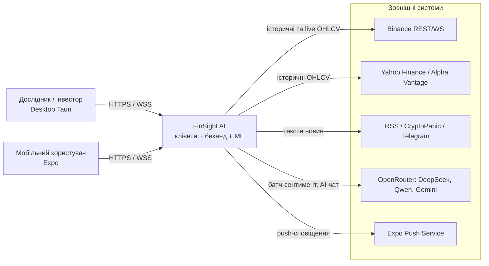
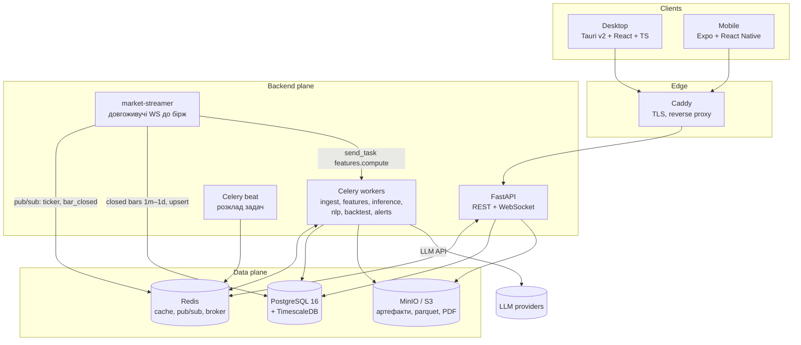
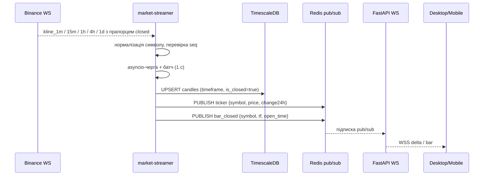
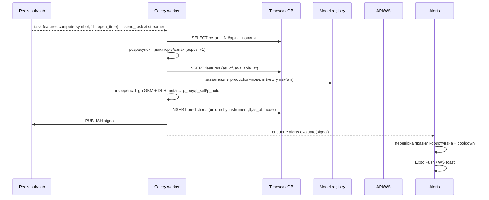
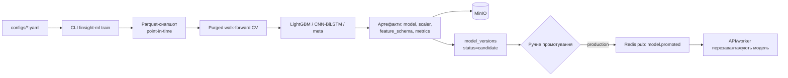
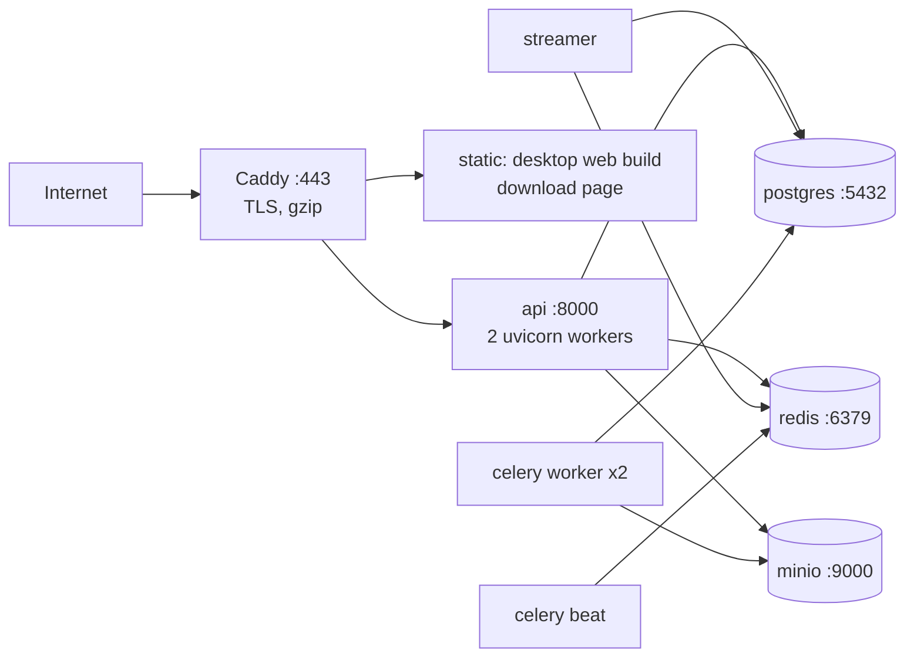

# FinSight AI — Архітектура системи

Версія: 1.1 · Дата: 2026-11-17 · Статус: чернетка для узгодження з науковим керівником

---

## 1. Цілі, обмеження, принципи

### 1.1. Цілі

| ID | Ціль | Критерій досягнення |
|---|---|---|
| G1 | Єдиний бекенд для двох клієнтів | Десктоп і мобільний використовують один API-контракт, 0 дублювання бізнес-логіки |
| G2 | Потокові дані з мінімальною затримкою | Оновлення котирувань у UI ≤ 2 с (p95) від моменту біржової події |
| G3 | Відтворювані ML-прогнози | Кожен прогноз прив'язаний до версії моделі, версії ознак і хешу датасету |
| G4 | Доказова якість моделей | Walk-forward бектест із комісією 0.1%, метрики гірші за baseline не приймаються |
| G5 | Захист диплома «без інтернету» | Демо-режим із записаними даними та локальним fallback-сентиментом |
| G6 | Експлуатаційна простота | Один VPS, Docker Compose, відновлення з бекапу ≤ 30 хв |

### 1.2. Обмеження

- Один розробник (студент), ~25 год/тиждень (≈3 повних робочих дні; узгоджено з 05-roadmap), горизонт — курсова (грудень 2026) + диплом (червень 2027).
- Без GPU у production; навчання глибоких моделей — CPU або безкоштовний GPU (Colab/Kaggle).
- Без реального виконання торгових ордерів: система аналітична, не брокер.
- Безкоштовні/умовно-безкоштовні джерела даних: Binance, Yahoo Finance, Alpha Vantage (free tier),
  RSS/CryptoPanic, публічні Telegram-канали.
- Бюджет на LLM — мінімальний, тому масова обробка новин іде на дешевих моделях із кешуванням.

### 1.3. Принципи

1. **Server-side intelligence.** Уся аналітика й ML — на сервері. Клієнти лише відображають і керують.
2. **Contract-first.** OpenAPI — джерело істини; TS-клієнт генерується, а не пишеться руками.
3. **Modular monolith.** Чіткі модулі з явними межами, але один деплой. Мікросервіси — антискоуп.
4. **Point-in-time за замовчуванням.** Жодна ознака не потрапляє в навчання, якщо на момент прогнозу її ще не існувало.
5. **Ідемпотентність.** Повторний запуск задачі не створює дублів (upsert + унікальні ключі).
6. **Graceful degradation.** Падіння LLM, біржі чи Redis не зупиняє UI: кеш, останні відомі дані, явний статус «stale».

---

## 2. Ключові архітектурні рішення (ADR)

| ADR | Рішення | Альтернативи | Обґрунтування |
|---|---|---|---|
| 001 | Модульний моноліт + окремі процеси воркерів | Мікросервіси, serverless | Один розробник, спільна транзакційність, простіший деплой; межі модулів зберігаються через ports/adapters |
| 002 | Тонкі клієнти, ML лише на сервері | Вбудований Python/TFLite у Tauri | Tauri не містить Python runtime; мобільний пристрій не тягне PyTorch; єдина версія моделі для всіх |
| 003 | PostgreSQL 16 + TimescaleDB як основне сховище | InfluxDB, ClickHouse | Реляційна цілісність + time-series в одній БД; знайомий SQL; безкоштовно; достатньо для 30–50 млн рядків |
| 004 | Redis: кеш + pub/sub + брокер Celery | RabbitMQ + Memcached | Менше рухомих частин; pub/sub дає realtime-доставку, Redis — черги та кеш |
| 005 | Окремий довгоживучий сервіс `market-streamer` | Celery-задача на WebSocket | Celery не призначений для постійних з'єднань; потрібен supervisor, реконект, heartbeat |
| 006 | OpenAPI → `openapi-typescript` + `openapi-fetch` | Рукописні DTO, tRPC | Python-бекенд не дає спільних типів; генерація гарантує синхронність контракту |
| 007 | Feature store: Parquet-снапшоти + таблиця `features` | Feast, Tecton | Надлишково для одного проєкту; Parquet + manifest hash дає відтворюваність |
| 008 | LightGBM як основна модель, deep learning — другий етап | Відразу Transformer | Швидкий baseline, інтерпретованість, менший ризик не встигнути; deep — дослідницька частина диплома |
| 009 | Tauri v2 замість Electron | Electron | Бандл ~10× менший, пам'ять ~3× менша; Rust-бекенд не потрібен, але WebView достатньо |
| 010 | Expo (managed + dev client за потреби) | React Native CLI | Швидший старт, OTA-оновлення, готові push/secure-store; bare — лише якщо знадобиться нативний модуль |
| 011 | JWT (access 15 хв) + refresh-rotation; WS — одноразовий ticket | Сесії в Redis, JWT у query | Stateless API, безпечний WS без токена в URL/логах |
| 012 | Деплой: 1 VPS, Docker Compose, Caddy TLS | Kubernetes, Fly.io + керовані сервіси | Вартість і складність; k8s — антискоуп; Caddy автоматизує сертифікати |
| 013 | Монорепо: pnpm + Turborepo (JS), uv workspace (Python), `just` як єдина точка входу | Nx, Make | Turborepo швидкий і простий; uv керує Python-пакетами; `just` уніфікує команди |
| 014 | Артефакти моделей у S3-сумісному MinIO | Git LFS, локальний диск | Версіонування, відтворюваність, безкоштовно локально; у prod — будь-який S3. **Курсова:** локальна ФС за тим самим інтерфейсом `ArtifactStore` (`STORAGE_BACKEND=local`), MinIO підключається в D0 без зміни коду |

---

## 3. Контекст системи (C4 L1)



## 4. Контейнери (C4 L2)



### 4.1. Межі модулів бекенду

| Модуль | Відповідальність | Залежності |
|---|---|---|
| `market` | Інструменти, свічки, котирування, якість даних | PG, Redis, Binance/Yahoo adapters |
| `features` | Індикатори, feature registry, point-in-time снапшоти | `market`, MinIO |
| `risk` | HMM-режими, Isolation Forest, VaR/CVaR, Sharpe, MaxDD | `features`, PG |
| `portfolio` | Портфелі, транзакції, PnL, оптимізатор Марковіца | `market`, `risk` |
| `forecast` | Розмітка, навчання, інференс, ансамбль, реєстр моделей | `features`, MinIO, PG |
| `backtest` | Walk-forward рушій, метрики, звіти | `forecast`, `market` |
| `news` | Інгестія, дедуплікація, LLM-сентимент, агрегація | PG, Redis, LLM adapter |
| `assistant` | AI-чат із tool-calling, RAG по портфелю/новинах | `news`, `portfolio`, `forecast` |
| `alerts` | Правила, оцінка тригерів, push, дедуплікація | Redis, Expo Push adapter |
| `identity` | Користувачі, JWT, ролі | PG |

Правило: модуль не імпортує `infra` іншого модуля напряму — тільки через інтерфейс (port) у `domain`.

### 4.2. Шари всередині `services/api`

```
app/
├── main.py                 # створення FastAPI, middlewares, lifespan
├── core/                   # config, security, logging, errors, telemetry
├── api/v1/                 # presentation: routers, schemas (request/response)
├── domain/                 # entities, value objects, ports (Protocol/ABC)
├── services/               # use cases, транзакційні сценарії
└── infra/                  # SQLAlchemy models, repositories, exchange/LLM/push adapters, cache
```

Напрямок залежностей: `api → services → domain ← infra`. Domain не знає про FastAPI, SQLAlchemy та зовнішні API.

---

## 5. Потоки даних

### 5.1. Live-потік котирувань



Особливості:

- `market-streamer` — asyncio-сервіс із supervisor: exponential backoff (1→30 с), jitter, heartbeat, перевірка «свіжості» (якщо немає повідомлень > 30 с — реконект).
- Один процес — одне з'єднання на біржу; підписки керуються конфігом, а не запитами клієнтів.
- **Запис у БД — поза циклом отримання WS:** закриті барами потрапляють у чергу й пишуться батчем раз на секунду, щоб повільний диск не блокував потік.
- **Після реконекту/рестарту** сервіс догружає пропущені закриті бари через REST від останнього `open_time` у БД, робить ідемпотентний upsert і повертається до live-потоку. Окремого writer-процесу немає.
- UI отримує **лише агреговані 1m бари та тікер**, не сирі trades (економія трафіку та CPU мобільного).
- Backpressure: тікер-дельти коалесцюються (не більше 2 оновлень/с на символ на клієнта), барам присвоюється монотонний `seq` на канал.
- **Таймфрейми.** Streamer підписується не лише на `kline_1m` (для тікера), а й на `kline_15m/1h/4h/1d` (комбіновані стріми Binance, ~50 стрімів на 10 символів — далеко від ліміту). Закритий бар будь-якого TF пишеться в `candles` одразу; без цього інференс на закритті 1h-бару неможливий (щоденний backfill о 03:00 UTC — лише страхувальна догрузка).
- **Доставка події `bar_closed`.** Redis pub/sub не гарантує доставку, а Celery-задачі не є підписниками. Тому streamer після успішного upsert напряму ставить `features.compute` у чергу Celery (`send_task`, ідемпотентний ключ), а pub/sub використовується лише для WS-розсилки клієнтам. Страховка: beat-задача `features.catchup` раз на 5 хв знаходить закриті бари без рядка в `features` і додає їх у чергу.
- **Акції** (Yahoo/Alpha Vantage) не мають WS: beat опитує закриті бари раз на 15 хв у торгові години й проходить тим самим шляхом (`upsert` → `features.compute`).

### 5.2. Історичне довантаження

Celery beat (щодня, 03:00 UTC) → `market.backfill`:

1. Для кожного активного інструмента й таймфрейму знайти останню закриту свічку.
2. Завантажити пропуск через REST із пагінацією (ліміт 1000 свічок/запит) і rate-limit backoff.
3. Валідація: монотонність часу, `low ≤ open/close ≤ high`, `volume ≥ 0`, відсутність дублів.
4. Upsert у `candles` за ключем `(instrument_id, timeframe, open_time)`.
5. Записати `ingestion_runs` (rows, gaps, duration, status); при gap > 3 барів — створити запис у `data_gaps` і повторити спробу.
6. Оновити continuous aggregates (`refresh_continuous_aggregate` за вікном).

### 5.3. Обчислення ознак та інференс (на закритті бару)



Ідемпотентність: ключ задачі `features:{instrument_id}:{tf}:{open_time}`; повторний запуск повертає той самий результат (upsert + `ON CONFLICT DO NOTHING` для прогнозу). Пропущені події добирає `features.catchup` (див. 5.1).

### 5.4. Навчання та реєстрація моделі



- Жодного автоматичного промотування: людина переглядає метрики та картку моделі.
- `dataset_hash` = SHA-256 маніфесту снапшоту (перелік файлів + розміри + хеші).
- Відкат: попередня `production` переводиться в `archived`, нова — вручну назад.

### 5.5. Алерти та push

1. Інференс-задача (worker) після запису прогнозу ставить `alerts.evaluate` у чергу `alerts`; Redis pub/sub лишається лише для WS-доставки клієнтам.
2. `alerts.evaluate` перевіряє активні правила (наприклад: `signal=BUY AND confidence ≥ 0.7 AND sentiment_24h > 0.2`).
3. Дедуплікація: ключ `alert:{alert_id}:{instrument}:{bucket}` з TTL = cooldown (за замовчуванням 4 год).
4. Доставка: Expo Push (мобільний), WS-toast (десктоп), запис у `alert_events` незалежно від успіху доставки.
5. Тихі години користувача враховуються; критичні алерти (anomaly high) ігнорують quiet hours за прапорцем.

---

## 6. Технологічний стек

| Шар | Вибір | Версія | Чому саме це | Що відхилено |
|---|---|---|---|---|
| API | FastAPI + Pydantic v2 | 0.11x / 2.x | Async, OpenAPI «з коробки», типізація | Django REST (важчий), Flask (менше async) |
| ASGI | uvicorn + gunicorn (prod) | — | Стандарт | Hypercorn |
| ORM/міграції | SQLAlchemy 2.0 async + Alembic | 2.x | Async, зріла екосистема | Tortoise ORM |
| Черги | Celery + Redis | 5.x | Періодичні задачі, retry, routing | RQ (менш гнучкий), Dramatiq |
| БД | PostgreSQL + TimescaleDB | 16 / 2.17+ | Гіпертаблиці, компресія, continuous aggregates | InfluxDB (слабші реляційні зв'язки) |
| Кеш/pubsub | Redis 7 | 7.x | Один компонент на 3 ролі | RabbitMQ (зайвий) |
| Об'єкти | MinIO (S3 API) | latest | Локально безкоштовно, у prod — S3 | Git LFS (погано для бінарників) |
| Data/ML | pandas, numpy, scipy, scikit-learn | актуальні | База | — |
| Індикатори | Власна векторизована реалізація (`finsight_ml/features/indicators.py`), звірка з `ta`/TA-Lib у тестах | — | Нуль нативних залежностей, повний контроль над point-in-time, один код для train і serve | TA-Lib (збірка на Windows), `ta` як runtime-залежність (малопідтримуваний) |
| Градієнтний бустинг | LightGBM | 4.x | Швидкість, категоріальні ознаки, quantile-режим | XGBoost (порівнянно), CatBoost |
| Deep | PyTorch | 2.x | Гнучкість, 1D-CNN/BiLSTM/Transformer | TensorFlow (важчий деплой) |
| HMM | hmmlearn | 0.3.x | Простий API, достатньо для 4 станів | Власна реалізація (ризик помилок) |
| Аномалії | scikit-learn IsolationForest | — | Швидко, без учителя | Autoencoder (надлишково) |
| Оптимізація | scipy.optimize (SLSQP) | — | Обмеження, невелика розмірність | CVXPY (ще одна залежність) |
| LLM | OpenAI-сумісний клієнт через OpenRouter | — | Єдиний інтерфейс до DeepSeek/Qwen/Gemini | Прямі SDK кожного провайдера |
| Desktop | Tauri v2 + React 19 + TS + Vite | — | Малий бандл, нативні вікна | Electron |
| Графіки desktop | TradingView Lightweight Charts + ECharts | — | Свічки/обсяги + складні дашборди | D3 з нуля |
| Графіки mobile | victory-native (Skia) | — | Продуктивність, жести, свічки | WebView-графіки |
| Mobile | Expo (актуальний stable SDK) + RN + TS + expo-router | — | Швидкий старт, push, secure-store | RN CLI |
| Стан/запити | TanStack Query + Zustand (UI-стан) | — | Кеш, retry, інвалідація | Redux Toolkit (більше boilerplate) |
| Стилі | Tailwind CSS (desktop), NativeWind (mobile) | — | Спільні токени дизайну | styled-components |
| Валідація | Zod | — | Runtime-перевірка форм і налаштувань | Yup |
| Тести JS | Vitest + Testing Library; Playwright (desktop web) | — | Швидко + e2e | Jest (повільніший) |
| Тести Python | pytest + hypothesis + pytest-asyncio | — | Стандарт | unittest |
| Якість Python | ruff + mypy (strict для domain) | — | Швидкий лінтер + типи | flake8/black окремо |
| Якість JS | ESLint flat + Prettier + tsc --noEmit | — | Стандарт монорепо | — |
| CI/CD | GitHub Actions + GHCR | — | Безкоштовно для публічного репо | GitLab CI |

---

## 7. Нефункціональні вимоги та SLO

| Категорія | Вимога | Ціль |
|---|---|---|
| Продуктивність | GET свічок (1000 барів, з кешу) | p95 ≤ 150 мс |
| Продуктивність | GET дашборду портфеля (агрегати) | p95 ≤ 400 мс |
| Продуктивність | Інференс на один бар | ≤ 500 мс (CPU) |
| Продуктивність | WS-доставка від `bar_closed` | p95 ≤ 2 с |
| Доступність | API у години захисту/демо | ≥ 99% |
| Надійність | Втрата даних при рестарті | 0 (REST-догрузка + upsert) |
| Повнота даних | Покриття 1h-свічок за 2 роки | ≥ 98% |
| Безпека | Паролі | Argon2id |
| Безпека | Rate limit | 120 req/хв/користувач, 10 req/хв на важкі ендпоінти |
| Масштаб | Інструменти / користувачі | 50 / 20 (дипломний масштаб) |
| Дані | Обсяг свічок | ~30 млн рядків, ≤ 5 ГБ до компресії |
| Відновлення | RPO / RTO | 24 год / 30 хв |
| Спостережуваність | Логи | JSON, correlation_id на кожен запит/задачу |

---

## 8. Безпека

- **Авторизація:** JWT access (15 хв, HS256 у dev / RS256 у prod), refresh (30 днів) формату
  `{jti}.{secret}` із ротацією; у БД зберігається `jti` + `SHA-256(secret)` (висока ентропія не
  потребує Argon2); повторне використання старого refresh → відкликати всю сім'ю токенів.
- **WS:** `POST /auth/ws-ticket` → одноразовий ticket (60 с, Redis). Клієнт відкриває з'єднання
  та протягом 5 с надсилає `{"op":"auth","ticket":"..."}` першим повідомленням; у URL токен не потрапляє.
- **Паролі:** Argon2id (`memory_cost=64MB, time_cost=3`).
- **Режим `single_user`:** дозволений лише при `APP_ENV` ∈ {local, demo}; у staging/prod сервіс відмовляється стартувати (без цього VPS опиниться в мережі без авторизації).
- **Ізоляція даних:** усі запити до портфелів/алертів фільтруються за `user_id` на рівні репозиторію;
  інтеграційні тести перевіряють спробу доступу до чужого ресурсу (очікується 404, не 403).
- **Валідація:** Pydantic на вході, Zod на клієнті; жодних «сирих» SQL-конкатенацій.
- **CORS:** білий список origin'ів; у Tauri — `tauri://localhost` (macOS/Linux) і `http://tauri.localhost`
  (Windows) + dev-URL.
- **Tauri:** CSP без `unsafe-inline`, дозволені лише `connect-src` до власного API; оновлення підписані.
- **Мобільний:** refresh-токен у `expo-secure-store`, не в MMKV; MMKV — лише для некритичного кешу UI.
- **Секрети:** `.env` (dev) / змінні оточення (prod), ніколи в бандлі клієнта; `gitleaks` у CI.
- **LLM-безпека:** текст новини — недовірені дані; system prompt явно ігнорує інструкції з контенту;
  відповідь валідується структурованою JSON-схемою; інструменти асистента — лише читання в межах `user_id`.
- **Залежності:** `pip-audit`, `npm audit --omit=dev`, `trivy` на образах; Dependabot щотижня.
- **Обмеження зовнішніх API:** ключі на сервері, проксі для LLM; клієнт ніколи не ходить у Binance напряму.

### 8.1. Юридичні та етичні застереження

- Система **не є інвестиційною рекомендацією**; UI, PDF-звіти та відповіді асистента містять дисклеймер.
- Сирі біржові дані не редистрибутуються; використання — згідно з умовами API Binance.
- Yahoo Finance — неофіційний доступ для дослідницьких/освітніх цілей; для production-сценарію
  передбачений адаптер Alpha Vantage або ліцензованого провайдера.
- Telegram — лише публічні канали, read-only; персональні дані учасників не зберігаються.
- LLM: не надсилати персональні дані; тексти новин обробляються як публічний контент; логи мінімізуються.
- Персональні дані користувачів: мінімум (email, хеш пароля), підтримка видалення акаунта з анонімізацією.

---

## 9. Розгортання

### 9.1. Локальна розробка

```
docker compose -f infra/compose/docker-compose.dev.yml up -d   # postgres, redis, minio
uv run uvicorn app.main:app --reload --port 8000               # services/api
uv run celery -A app.worker worker -l info -P solo -Q default,ingest,features,inference,nlp,alerts   # worker (-P solo — для Windows; prefork лише в Linux-контейнерах)
uv run celery -A app.worker beat -l info                       # beat
uv run python -m finsight_streamer                             # streamer
pnpm --filter desktop tauri dev                                # desktop
pnpm --filter mobile expo start                                # mobile
```

Інфраструктура — в Docker; код — локально (hot reload, debugger). Повний compose — для перевірки «як у prod».

### 9.2. Production (один VPS: 4 vCPU / 8 ГБ / 80 ГБ SSD)



- Caddy — автоматичний Let's Encrypt, HTTP/2; rate limit — на рівні API (Redis), щоб працював
  незалежно від проксі та для WS-повідомлень.
- Healthchecks у compose; `restart: unless-stopped`; ліміти пам'яті для кожного сервісу.
- Бекапи: `pg_dump` щодня + WAL-архівування раз на годину (опційно), зберігання 14 днів у S3/MinIO,
  щотижнева перевірка відновлення на staging.
- Міграції — окремий job перед стартом API (`alembic upgrade head`), не в entrypoint кожної репліки.
- Desktop-додаток розповсюджується як підписаний інсталятор (GitHub Releases); mobile — Expo EAS Build
  (internal distribution / TestFlight).

### 9.3. Середовища

| Середовище | Призначення | Дані | LLM |
|---|---|---|---|
| `local` | Розробка | Реальні + seed-фікстури | Реальний, малий ліміт |
| `staging` | Перевірка релізу | Копія за останні 30 днів | Мок/дешевий |
| `prod` | Демо та захист | Повні дані | Реальний + fallback |
| `demo` | Офлайн-захист | Записані снапшоти | Повністю замокані відповіді |

Перемикання — `APP_ENV` + `DEMO_MODE=true`.

---

## 10. Спостережуваність

- **Логи:** `structlog` JSON, поля `ts, level, service, correlation_id, user_id, route, duration_ms, error_code`.
  Клієнт передає `X-Request-ID`, сервер повертає його у відповіді.
- **Метрики (Prometheus):** `http_request_duration_seconds`, `ws_connections`, `celery_task_duration`,
  `ingestion_lag_seconds`, `candles_freshness_seconds`, `inference_duration`, `llm_tokens_total`, `llm_cost_usd`.
- **Дашборд (Grafana, optional):** свіжість даних по символах, черга Celery, помилки інференсу, витрати LLM.
- **Алерти (Telegram-бот адміністратора):** API down, ingestion lag > 5 хв, частка помилок > 5%, витрати LLM > $X/добу.
- **Трейсинг:** OpenTelemetry (stretch) — наскрізний trace від HTTP до Celery (propagate через headers).
- **Продуктова аналітика:** таблиця `llm_usage`, `ingestion_runs`, `model_predictions` як джерела істини.

---

## 11. Антискоуп (свідомо не робимо)

- Реальне виконання ордерів, підключення до брокерських рахунків, зберігання коштів.
- Трейдинг у реальному часі з гарантією низької затримки (HFT), colocation.
- Kubernetes, service mesh, multi-region.
- Власні конектори до 10+ бірж: лише Binance + Yahoo/Alpha Vantage.
- Скрапінг соцмереж поза публічними RSS/Telegram (юридичні ризики).
- Мультитенантний SaaS із білінгом.
- Навчання моделей на пристрої користувача.

---

## 12. Архітектурні ризики та пом'якшення

| Ризик | Вплив | Ймовірність | Пом'якшення |
|---|---|---|---|
| Yahoo Finance неофіційний і ламається | Немає даних по акціях | Висока | Абстракція `MarketDataProvider`; Alpha Vantage як другий адаптер; кеш останніх даних; демо-снапшот |
| Ліміти Binance/Telegram/CryptoPanic | Пропуски даних | Середня | Backoff, пагінація, нічні довантаження, дедуплікація, локальний кеш |
| LLM недоступний або дорогий | Немає сентименту/чату | Середня | Кеш за хешем, batch, дешева модель, fallback VADER/лексикон, `DEMO_MODE` |
| TA-Lib не збирається на Windows/CI | Блок старту | Висока | Власні індикатори на pandas/numpy; TA-Lib/`ta` — лише «оракул» у тестах |
| Перенавчання/витік даних | Фальшиві метрики, провал захисту | Висока | Purged walk-forward, embargo, point-in-time joins, тест на leakage, рев'ю ознак; HMM/IF/scaler — окремо в кожному фолді |
| Немає історії новин для точкового ablation | E3/E11 не виконати за схемою 12/2/1 | Висока | Збір RSS/CryptoPanic з C1 (лише сирий текст); `available_at` + бекфіл із публічного датасету; скорочена схема фолдів (04 §10.4) |
| Lookahead-упередження LLM (модель «знає» майбутнє історичних новин) | Завищений внесок сентименту в ablation | Середня | Прозоро описати як обмеження; порівняти live-період (без упередження) і бекфіл-період окремо |
| Довге навчання deep-моделі | Не встигаємо | Середня | LightGBM-first; малі вікна, early stopping, CPU-профіль, Colab за потреби |
| Мобільний забирає забагато часу | Немає демо | Висока | Мобільний — «should», read-only мінімум; desktop — пріоритет |
| Tauri-підпис/оновлення | Складнощі розповсюдження | Низька | Web-версія desktop як fallback для демо |
| Зміна вимог кафедри | Переробка розділів | Середня | Розділи пишуться паралельно зі спринтами, а не в кінці |

---

## 13. Що фіксуємо для дипломної роботи

- **Новизна/внесок:** дворівневий ансамбль (tabular + sequence) із meta-класифікатором, що враховує
  режим ринку та сентимент; калібровані ймовірності та прогнозні інтервали; walk-forward бектест
  з повним перетренуванням і витратами.
- **Порівняльний аналіз:** baseline (логістична регресія) vs LightGBM vs CNN-BiLSTM vs meta-ensemble,
  а також ablation без сентименту та без HMM-режиму.
- **Інженерний внесок:** monorepo «2-в-1», контракт-first API, point-in-time feature store,
  відтворюваність експериментів (dataset hash + model registry).
