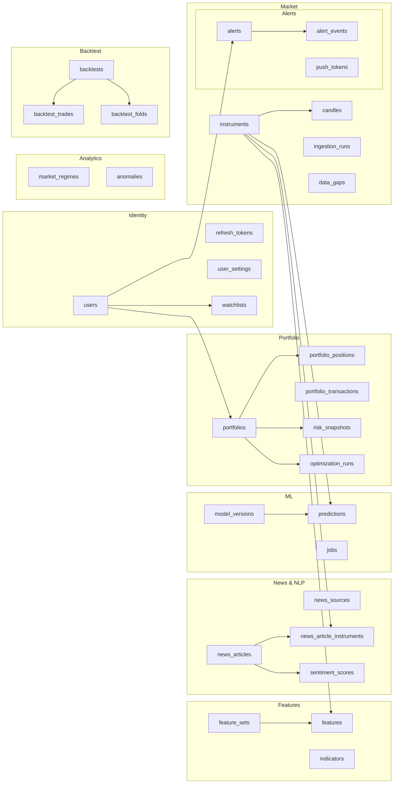

# FinSight AI — Модель даних

Версія: 1.1 · СУБД: PostgreSQL 16 + TimescaleDB 2.17+ · Міграції: Alembic

---

## 1. Принципи

1. **UTC усюди.** Усі часові поля — `timestamptz`, зберігаються в UTC; таймзона — турбота презентації.
2. **Гроші vs аналітика.** Ціни свічок — `double precision` (швидкість, достатня точність для аналізу).
   Суми, кількість активів і PnL у портфелі — `numeric(28,10)` (точність бухгалтерії).
3. **Ідемпотентність.** Природні унікальні ключі + `ON CONFLICT ... DO UPDATE` для ринкових даних.
4. **Point-in-time.** Кожен рядок ознак має `as_of` (до якого моменту дані) і `available_at`
   (коли система реально могла їх знати). Навчання джойнить лише `available_at <= t_decision`.
5. **Не видаляємо історію.** Прогнози, ризик-снапшоти й бектести — append-only; виправлення через статуси.
6. **UUIDv7** для бізнес-сутностей (часова локальність індексів), генерується в застосунку.

---

## 2. Огляд доменів



---

## 3. Основні таблиці

### 3.0. `users` та `refresh_tokens`

```sql
CREATE TABLE users (
    id            uuid PRIMARY KEY,
    email         citext UNIQUE NOT NULL,
    password_hash text   NOT NULL,                 -- Argon2id
    display_name  text   NOT NULL,
    role          text   NOT NULL DEFAULT 'user' CHECK (role IN ('user','admin')),
    is_active     boolean NOT NULL DEFAULT true,
    created_at    timestamptz NOT NULL DEFAULT now(),
    updated_at    timestamptz NOT NULL DEFAULT now(),
    deleted_at    timestamptz                      -- анонімізація замість фізичного видалення
);

CREATE TABLE refresh_tokens (
    jti         uuid PRIMARY KEY,
    user_id     uuid NOT NULL REFERENCES users(id),
    family_id   uuid NOT NULL,                     -- ротаційна «родина»; reuse → відкликати всю
    secret_hash text NOT NULL,                     -- SHA-256(secret)
    issued_at   timestamptz NOT NULL DEFAULT now(),
    expires_at  timestamptz NOT NULL,
    used_at     timestamptz,
    revoked_at  timestamptz,
    ip          inet,
    user_agent  text
);
CREATE INDEX refresh_tokens_user_idx   ON refresh_tokens (user_id);
CREATE INDEX refresh_tokens_family_idx ON refresh_tokens (family_id);
```

У `AUTH_MODE=single_user` seed створює одного демо-користувача; усі `user_id` у решті таблиць заповнюються ним, тому перехід на JWT у D0 не потребує міграції даних.

### 3.1. `instruments` — довідник активів

| Колонка | Тип | Обмеження | Опис |
|---|---|---|---|
| `id` | uuid | PK | Внутрішній ідентифікатор |
| `symbol` | text | UNIQUE, `^[A-Z0-9._-]{2,20}$` | Канонічний символ: `BTCUSDT`, `AAPL` |
| `name` | text | NOT NULL | Людська назва |
| `asset_class` | text | CHECK in (`crypto`,`stock`,`etf`,`index`) | Клас |
| `exchange` | text | NOT NULL | `binance`, `nasdaq`, `nyse` |
| `quote_currency` | text | NOT NULL | `USDT`, `USD` |
| `tick_size` | numeric(28,10) | | Мінімальний крок ціни |
| `lot_size` | numeric(28,10) | | Мінімальний крок кількості |
| `is_active` | boolean | default true | Чи збираємо дані |
| `metadata` | jsonb | default `{}` | Сектор, біржа, особливості |
| `created_at` | timestamptz | default now() | |

`instrument_aliases(source, source_symbol, instrument_id)` — мапінг зовнішніх символів
(`binance:BTCUSDT`, `yahoo:BTC-USD`, `coingecko:bitcoin`) → внутрішній `instrument_id`.
Унікальність `(source, source_symbol)`.

### 3.2. `candles` — гіпертаблиця OHLCV

```sql
CREATE TABLE candles (
    instrument_id uuid        NOT NULL REFERENCES instruments(id),
    timeframe     text        NOT NULL CHECK (timeframe IN ('1m','15m','1h','4h','1d')),
    open_time     timestamptz NOT NULL,
    open          double precision NOT NULL,
    high          double precision NOT NULL,
    low           double precision NOT NULL,
    close         double precision NOT NULL,
    volume        double precision NOT NULL,
    quote_volume  double precision,
    trades        integer,
    is_closed     boolean     NOT NULL DEFAULT true,
    source        text        NOT NULL,
    ingested_at   timestamptz NOT NULL DEFAULT now(),
    PRIMARY KEY (instrument_id, timeframe, open_time),
    CHECK (high >= low),
    CHECK (high >= open AND high >= close),
    CHECK (low  <= open AND low  <= close),
    CHECK (volume >= 0)
);

SELECT create_hypertable('candles', 'open_time',
       chunk_time_interval => INTERVAL '7 days');

CREATE INDEX candles_lookup_idx
    ON candles (instrument_id, timeframe, open_time DESC);

ALTER TABLE candles SET (
    timescaledb.compress,
    timescaledb.compress_segmentby = 'instrument_id,timeframe',
    timescaledb.compress_orderby   = 'open_time DESC'
);
SELECT add_compression_policy('candles', INTERVAL '90 days');
```

- **Чому одна таблиця на всі таймфрейми:** простіше обслуговувати, єдиний шлях запитів; 1m-рядки
  домінують, але 7-денні чанки однаково ефективні.
- **Чому не continuous aggregates:** таймфрейми завантажуються нативно з біржі (дешево, один запит на TF),
  а узгодженість перевіряється нічною валідацією. CAGG — можлива оптимізація, не вимога.
- **Сирі trades не зберігаються.** Потік агрегується до 1m у `market-streamer`; історія тіків не потрібна.
- **Оцінка обсягу:** 10 крипто-символів × 3 роки × 1m ≈ 16 млн рядків (20 символів ≈ 32 млн; ~2–6 ГБ), стиснення ×5–8; рядки 15m/1h/4h/1d разом менше 2% обсягу.

### 3.3. `ingestion_runs` та `data_gaps`

| `ingestion_runs` | | |
|---|---|---|
| `id` | bigserial PK | |
| `job_name` | text | `backfill`, `stream_ingest`, `news_fetch` |
| `source` | text | `binance`, `yahoo`, `rss` |
| `instrument_id` | uuid NULL | |
| `timeframe` | text NULL | |
| `started_at`, `finished_at` | timestamptz | |
| `rows_written` | integer | |
| `gaps_found` | integer | |
| `status` | text | `running`,`ok`,`partial`,`failed` |
| `error` | text NULL | |

`data_gaps(id, instrument_id, timeframe, gap_start, gap_end, bars_missing, detected_at, resolved_at)` —
один рядок на проміжок; використовується дашбордом якості даних і задачею довантаження.

### 3.4. `indicators` — вітрина для UI

Гіпертаблиця з явними колонками (швидкі запити для графіків):

`(instrument_id, timeframe, open_time)` PK, далі `ema20, ema50, ema200, rsi14, macd, macd_signal,
macd_hist, bb_upper, bb_mid, bb_lower, atr14, obv, computed_at`.

Розраховується на закритті бару (Celery), пише лише закриті барами. Використовується API для накладання
індикаторів; для ML — окремий `features`.

### 3.5. `feature_sets` та `features`

`feature_sets`:

| Колонка | Тип | Опис |
|---|---|---|
| `id` | uuid PK | |
| `name` | text | `core_market_v1` |
| `version` | integer | 1, 2, ... |
| `schema_hash` | text | SHA-256 переліку ознак (ім'я, dtype, lookback) |
| `code_commit` | text | git SHA, що згенерував набір |
| `created_at` | timestamptz | |

`features`:

| Колонка | Тип | Опис |
|---|---|---|
| `instrument_id` | uuid | |
| `timeframe` | text | |
| `as_of` | timestamptz | Час закриття бару, до якого належить вектор |
| `available_at` | timestamptz | Коли вектор став доступним (≥ as_of + обробка) |
| `feature_set_id` | uuid | Версія схеми |
| `values` | jsonb | `{"rsi14": 61.2, "senti_24h": 0.34, ...}` |
| `quality_flags` | jsonb | `{"stale_news": false, "missing_volume": false}` |

PK `(instrument_id, timeframe, as_of, feature_set_id)`. Індекс `(as_of)` для віконних вибірок.

**Чому JSONB, а не 80 колонок:** схема ознак змінюється швидше за БД; для навчання все одно будується
Parquet-снапшот, де кожна ознака — окрема колонка. JSONB тут — журнал/аудит і джерело для снапшотів.
Гарячі ознаки для UI дублюються в `indicators` явними колонками.

### 3.6. Новини та сентимент

`news_sources(id, kind, name, url, is_active, trust_score)` — `rss`, `cryptopanic`, `telegram`.

`news_articles`:

| Колонка | Тип | Опис |
|---|---|---|
| `id` | uuid PK | |
| `source_id` | uuid FK | |
| `url` | text | Канонічний URL |
| `url_hash` | text | UNIQUE, SHA-256 канонічного URL |
| `content_hash` | text | SHA-256 нормалізованого тексту (дедуплікація) |
| `title`, `body` | text | |
| `language` | text | `en`, `uk`, `ru` |
| `published_at` | timestamptz | З джерела |
| `ingested_at` | timestamptz | Коли ми реально отримали запис |
| `available_at` | timestamptz | З якого моменту новину можна використовувати в ознаках: live → `ingested_at`; бекфіл → `published_at + 5 хв` |
| `availability_basis` | text | `live` \| `backfill_published_proxy` — для фільтрації в ablation і звітах |
| `dedup_cluster_id` | uuid NULL | Група схожих новин (SimHash/MinHash) |
| `raw` | jsonb | Сирий payload |

Індекси: `url_hash` UNIQUE, `(published_at DESC)`, `(available_at)`, GIN по `to_tsvector('simple', title || ' ' || body)`
(пошук), `(dedup_cluster_id)`.

`news_article_instruments(article_id, instrument_id, relevance numeric(4,3))` — прив'язка до тікерів
(правила + LLM + згадки в тексті); PK обидва поля.

`sentiment_scores(id, article_id, model, prompt_version, score numeric(4,3), confidence numeric(4,3),
labels jsonb, created_at)` — UNIQUE `(article_id, model, prompt_version)`. `score ∈ [-1, 1]`.

`sentiment_scores.labels`: `{"event_type":"regulation","horizon":"short","tickers":["BTC"]}`.

### 3.7. Режими ринку та аномалії

`market_regimes(instrument_id, timeframe, as_of, regime, proba jsonb, model_version_id, created_at)`,
PK `(instrument_id, timeframe, as_of, model_version_id)`.
`regime ∈ {bull, bear, range, high_vol}`; `proba = {"bull":0.71,...}`.

`anomalies(id, instrument_id, timeframe, detected_at, kind, score, features jsonb, resolved_at)` —
`kind ∈ {volume_spike, price_spike, spread_anomaly}`; індекс `(instrument_id, detected_at DESC)`.

### 3.8. ML-реєстр та прогнози

`model_versions`:

| Колонка | Тип | Опис |
|---|---|---|
| `id` | uuid PK | |
| `name` | text | `lgbm_core`, `cnn_bilstm_core`, `meta_ensemble` |
| `task` | text | `direction_3class`, `price_quantile`, `regime` |
| `algo` | text | `lightgbm`, `cnn_bilstm_attention`, `logreg` |
| `semver` | text | `1.3.0` |
| `status` | text | `candidate`,`production`,`archived`,`failed` |
| `params` | jsonb | Гіперпараметри |
| `metrics` | jsonb | Метрики CV та тесту |
| `artifact_uri` | text | `s3://models/lgbm_core/1.3.0/` |
| `feature_set_id` | uuid | |
| `dataset_hash` | text | Хеш маніфесту снапшоту |
| `trained_at` | timestamptz | |
| `promoted_at` | timestamptz NULL | |
| `notes` | text | |

Обмеження: частковий унікальний індекс — лише одна `production`-версія на `(name, task)`:
`CREATE UNIQUE INDEX ... ON model_versions(name, task) WHERE status = 'production';`

`predictions`:

| Колонка | Тип | Опис |
|---|---|---|
| `id` | uuid PK | |
| `instrument_id` | uuid | |
| `timeframe` | text | |
| `as_of` | timestamptz | Час закриття бару-джерела |
| `horizon_bars` | integer | 24 |
| `model_version_id` | uuid | Версія фінальної (meta) моделі |
| `p_buy`, `p_sell`, `p_hold` | numeric(5,4) | Сума = 1.0 (перевіряється) |
| `signal` | text | `BUY`,`SELL`,`HOLD` |
| `confidence` | numeric(5,4) | max(p) |
| `price_low`, `price_high` | double precision | Прогнозний коридор (80%) |
| `features_hash` | text | Хеш вектора ознак для відтворюваності |
| `component_versions` | jsonb | `{"lgbm_core":"<uuid>","cnn_bilstm_core":"<uuid>","hmm":"<uuid>"}` — усі версії, що брали участь (вимога G3) |
| `explanation` | jsonb | SHAP top-5 на момент інференсу (в API не перераховується, бо потрібна модель і вектор ознак) |
| `created_at` | timestamptz | |

UNIQUE `(instrument_id, timeframe, as_of, model_version_id)`.
Індекси `(instrument_id, as_of DESC)`.

`labels` — розмітка для навчання (append-only, **не** є point-in-time доступною до моменту `t1`):

`labels(instrument_id, timeframe, as_of, label_set_version, label, exit_price, exit_reason, t1, barrier_up, barrier_down, sample_weight)` —
PK `(instrument_id, timeframe, as_of, label_set_version)`; `t1` — момент виходу з позиції за бар'єром, використовується для purge/embargo.
Таблиця використовується лише пайплайном навчання і ніколи не читається інференсом.

`model_monitoring(id, model_version_id, window_start, window_end, psi, calibration_error, signal_share jsonb, created_at)` —
щоденний звіт дрейфу.

### 3.9. Портфелі

`portfolios(id, user_id, name, base_currency, created_at, updated_at, archived_at)` — `archived_at` реалізує soft-delete з API.

`portfolio_positions(portfolio_id, instrument_id, quantity numeric(28,10), avg_price numeric(28,10),
opened_at, updated_at)` — PK `(portfolio_id, instrument_id)`; поточна позиція.

`portfolio_transactions(id, portfolio_id, instrument_id, side, quantity, price, fee, executed_at, note)` —
журнал угод (джерело істини для PnL); позиції — денормалізований агрегат, що перераховується в тій же транзакції.

`risk_snapshots(id, portfolio_id, as_of, var_95, cvar_95, sharpe, sortino, max_drawdown,
annual_volatility, weights jsonb, method, created_at)`.

`optimization_runs(id, portfolio_id, as_of, method, constraints jsonb, weights jsonb,
expected_return, expected_volatility, sharpe, status, created_at)`.

### 3.10. Бектести

`backtests(id, user_id, name, strategy_config jsonb, instrument_scope jsonb, period_start, period_end,
mode text, status, metrics jsonb, equity_curve_uri, report_uri, error, created_at, finished_at)`.

`mode ∈ {static_model, walk_forward_retrain}`.

`backtest_folds(backtest_id, fold_no, train_start, train_end, val_start, val_end, test_start, test_end,
model_version_id, metrics jsonb)`.

`backtest_trades(backtest_id, seq, instrument_id, side, entry_at, entry_price, exit_at, exit_price,
quantity, fee, pnl, exit_reason, confidence, fold_no)`.

### 3.11. Алерти, push, налаштування

`alerts(id, user_id, name, rule jsonb, is_active, cooldown_minutes, quiet_hours jsonb, created_at)`.

Приклад `rule`:
```json
{
  "all": [
    {"fact": "signal", "operator": "eq", "value": "BUY"},
    {"fact": "confidence", "operator": "gte", "value": 0.70},
    {"fact": "sentiment_24h", "operator": "gt", "value": 0.20},
    {"fact": "instrument_id", "operator": "in", "value": ["<uuid>"]}
  ]
}
```
Валідація — JSON Schema; виконання — власний інтерпретатор (без `eval`).

`alert_events(id, alert_id, instrument_id, triggered_at, payload jsonb, delivered_channels jsonb,
delivery_status text)`.

`push_tokens(id, user_id, expo_token UNIQUE, platform, last_seen_at, is_active)`.

`user_settings(user_id PK, locale, theme, base_currency, quiet_hours, risk_profile, updated_at)`.

`watchlists(user_id, instrument_id, sort_order)` — PK `(user_id, instrument_id)`.

### 3.12. Службові таблиці

`jobs(id, user_id, kind, status, progress, payload jsonb, result jsonb, error, created_at, started_at,
finished_at)` — `kind ∈ {backtest, optimize, report, retrain}`, `status ∈ {queued,running,done,failed,cancelled}`.

`llm_usage(id, user_id NULL, purpose, model, prompt_version, tokens_in, tokens_out, cost_usd, latency_ms, created_at)` —
контроль витрат; щоденний агрегат для алерту бюджету.

`audit_log(id, user_id, action, entity, entity_id, ip, user_agent, payload jsonb, created_at)`.

---

## 4. Ключові інваріанти та перевірки

| Інваріант | Як забезпечується |
|---|---|
| Сума ймовірностей = 1 | CHECK `abs(p_buy+p_sell+p_hold-1) < 1e-6`; перевірка в сервісі |
| Свічка не змінюється після закриття | `is_closed` + тригер: забороняє зміну цін/обсягу при `is_closed = true`; дозволяє `false → true`; контрольована корекція джерела — окремою роллю з записом в `audit_log` |
| Компресія не блокує корекції | Політика стиснення — 90 днів; глибші виправлення — через `decompress_chunk` у службовій процедурі |
| Прогноз не дублюється | UNIQUE `(instrument,tf,as_of,model_version)` + `ON CONFLICT DO NOTHING` |
| Позиція = сума транзакцій | Перерахунок у тій самій транзакції; щонічна звірка `portfolio_reconcile` |
| Одна production-модель на задачу | Частковий UNIQUE-індекс |
| Немає витоку майбутнього | `available_at <= decision_time` у кожному запиті побудови датасету |
| Чужі дані недоступні | `WHERE user_id = :current_user` у репозиторіях + тести |

---

## 5. Point-in-time: як саме

```
Рішення приймається на закритті бару t (open_time + tf).
features[t].as_of      = t_close
features[t].available_at = t_close + processing_delay (секунди)

Новина доступна, коли available_at <= t_close (live: available_at = ingested_at; бекфіл: published_at + 5 хв, з прапорцем basis)
Мітка для навчання: перша подія в (t_close, t_close + H*tf]
```

Побудова тренувального набору:

```sql
SELECT f.values, i.*, l.label
FROM features f
JOIN labels l ON l.instrument_id = f.instrument_id
             AND l.timeframe = f.timeframe
             AND l.as_of = f.as_of
LEFT JOIN LATERAL (
    SELECT avg(s.score) FILTER (WHERE a.available_at > f.as_of - interval '24 hours') AS senti_24h,
           count(*) FILTER (WHERE a.available_at > f.as_of - interval '24 hours') AS news_count
    FROM news_article_instruments nai
    JOIN news_articles a ON a.id = nai.article_id
    JOIN sentiment_scores s ON s.article_id = a.id AND s.model = :senti_model
    WHERE nai.instrument_id = f.instrument_id
      AND a.available_at <= f.as_of
) n ON true
WHERE f.feature_set_id = :feature_set
  AND f.as_of BETWEEN :start AND :end
  AND f.available_at <= f.as_of + interval '5 minutes'
ORDER BY f.instrument_id, f.as_of;
```

Ознаки ніколи не «заглядають» у майбутнє: лаги, вікна та сентимент рахуються виключно з
`available_at <= decision_time`.

### 5.1. Історія новин і lookahead LLM

- **Проблема.** `ingested_at` для новин, завантажених заднім числом, дорівнює даті завантаження, а не даті події, тож «чесного» сентименту для історії до старту збору просто немає. Для бекфілу використовується `published_at + 5 хв` з `availability_basis='backfill_published_proxy'`; для live — `ingested_at`.
- **Звітність.** Усі метрики з сентиментом розділяються на період `live` та період `backfill`; ablation E3 показує обидва.
- **LLM знає майбутнє.** Модель, навчена після періоду новин, може «пам'ятати» наслідки подій. Для `backfill` це систематичне упередження; його потрібно явно описати в розділі «Обмеження» і не змішувати з live-результатами.
- **Збір починається з C1** (RSS, лише сирий текст, без LLM), щоб до лютого накопичити ≈ 3 місяці live-історії.

---

## 6. Індекси та продуктивність

| Запит | Індекс |
|---|---|
| Свічки за діапазон | `(instrument_id, timeframe, open_time DESC)` |
| Останній прогноз | `(instrument_id, timeframe, as_of DESC)` |
| Стрічка новин | `(published_at DESC)` + фільтр по sentiment через join |
| Пошук новин | GIN `to_tsvector` |
| Дашборд портфеля | PK позицій + `risk_snapshots(portfolio_id, as_of DESC)` |
| Черга алертів | `(is_active)` partial + Redis-дедуплікація |
| Feature-вікно | `(instrument_id, timeframe, as_of)` + `(as_of)` |

Правила: жодних `SELECT *` у репозиторіях гарячих шляхів; пагінація завжди; аналітичні агрегати —
кешуються в Redis із TTL 30–60 с (дашборди) та інвалідуються на `bar_closed`.

---

## 7. Політика зберігання

| Дані | Термін | Обґрунтування |
|---|---|---|
| Свічки 1m | 3 роки | Відтворюваність бектестів; далі — агрегати |
| Свічки 15m/1h/4h/1d | 5 років+ | Дослідження, довгі фолди |
| Новини та сентимент | 3 роки | Абляції, історія сентименту |
| Прогнози | 3 роки | Аудит, моніторинг дрейфу |
| Ризик-снапшоти | 2 роки | Історія портфеля |
| Логи застосунку | 90 днів | Діагностика |
| `llm_usage` | 1 рік | Контроль витрат |
| Бекапи БД | 14 днів | Відновлення |

Видалення — партійними задачами (`retention_cleanup`), не `DELETE` у гарячих шляхах. Для демо-снапшоту
терміни не застосовуються.

---

## 8. Міграції та сід

- Усі зміни схеми — Alembic-ревізії в `services/api/migrations/`; `alembic check` у CI.
- Розширення Timescale створюються ідемпотентно в міграції (`CREATE EXTENSION IF NOT EXISTS timescaledb`), як і `citext`.
- `alembic check` у CI без налаштування падатиме: Timescale автоматично створює службові індекси/таблиці. У `env.py` потрібен `include_object`, що їх ігнорує (за іменами `_timescaledb_*` та індексом `candles_open_time_idx`).
- UUIDv7 у Python 3.12 немає в стандартній бібліотеці: використати `uuid-utils` (або `uuid6`).
- Seed-скрипт (`scripts/seed.py`): 12 інструментів, 2 демо-портфелі, 30 новин, 1 демо-користувач.
- Демо-снапшот (`scripts/make_demo_snapshot.py`): вивантажує 90 днів 1h/1d + прогнози + новини в
  MinIO-бакет `demo/` для офлайн-захисту.
