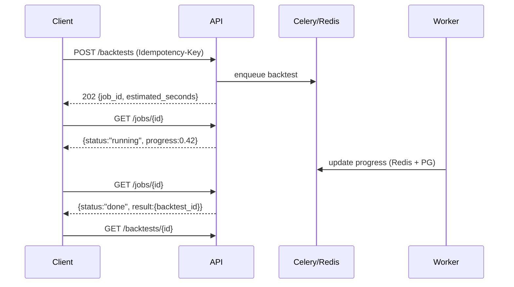
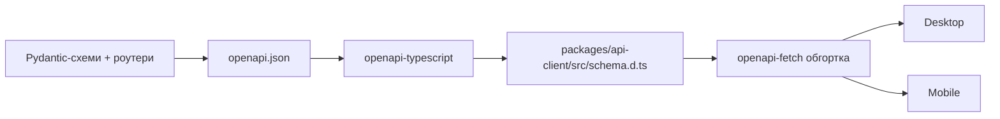

# FinSight AI — API та контракти

Версія API: `v1` · Базовий шлях: `/api/v1` · Формат: JSON (UTF-8) · Специфікація: OpenAPI 3.1

---

## 1. Загальні конвенції

| Аспект | Рішення |
|---|---|
| Версіонування | Шлях `/api/v1`; breaking changes — лише `v2`, старі ендпоінти живуть ≥ 1 семестр |
| Іменування | Ресурси в множині, `kebab-case` у шляхах, `snake_case` у полях JSON (узгоджено з Python) |
| Час | ISO 8601 з UTC: `2026-11-17T14:00:00Z` |
| Пагінація | Cursor: `?limit=100&cursor=<opaque>`; відповідь `{items, next_cursor, has_more}` |
| Фільтри | Явні query-параметри, повторювані (`?symbol=BTCUSDT&symbol=ETHUSDT`) |
| Сортування | `?sort=-as_of` (мінус — спадання), білий список полів |
| Кешування | `Cache-Control: public, max-age=5` для котирувань; `private, max-age=30` для дашбордів; `ETag` для свічок |
| Ідемпотентність | `Idempotency-Key` обов'язковий для POST, що створює довготривалі ресурси |
| Тяжкі операції | `202 Accepted` + `job_id`, статус через `GET /jobs/{id}` |
| Помилки | RFC 9457 `application/problem+json` |
| Rate limit | `429` + `Retry-After`; заголовки `X-RateLimit-Limit/Remaining/Reset` |
| Кореляція | Клієнт надсилає `X-Request-ID`, сервер повертає його ж у відповіді та логах |

### 1.1. Формат помилки

```json
{
  "type": "https://finsight.local/errors/validation",
  "title": "Request validation failed",
  "status": 422,
  "detail": "timeframe must be one of 1m, 15m, 1h, 4h, 1d",
  "instance": "/api/v1/instruments/7f.../candles",
  "code": "VALIDATION_ERROR",
  "request_id": "01JCG...",
  "errors": [
    {"field": "timeframe", "message": "invalid value", "code": "enum"}
  ]
}
```

Коди (`code`) — стабільні для клієнтської логіки: `VALIDATION_ERROR`, `UNAUTHORIZED`, `FORBIDDEN`,
`NOT_FOUND`, `CONFLICT`, `RATE_LIMITED`, `UPSTREAM_UNAVAILABLE`, `MODEL_NOT_READY`, `JOB_FAILED`,
`DEMO_MODE_RESTRICTED`.

### 1.2. Авторизація

```
Authorization: Bearer <access_jwt>
```

| Шлях | Метод | Тіло | Відповідь |
|---|---|---|---|
| `/auth/register` | POST | `{email, password, display_name}` | `201 {user, access_token, refresh_token}` |
| `/auth/login` | POST | `{email, password}` | `200 {user, access_token, refresh_token}` |
| `/auth/refresh` | POST | `{refresh_token}` | `200 {access_token, refresh_token}` (rotation) |
| `/auth/logout` | POST | `{refresh_token}` | `204` (відкликати сім'ю токенів) |
| `/auth/me` | GET | — | `200 {user, settings}` |
| `/auth/ws-ticket` | POST | — | `201 {ticket, expires_in: 60}` |

- Access JWT: 15 хв, claims `sub`, `sid`, `role`, `exp`, `iat`, `jti`.
- Refresh: `{jti}.{secret}` (256-bit secret); у БД — `jti` + `SHA-256(secret)` (висока ентропія не
  потребує Argon2); ротація при кожному використанні; повторне використання → відкликати всю родину.
- У `AUTH_MODE=single_user` (курсова/локальний демо-режим) `/auth/*` повертає фіксованого демо-користувача,
  а захищені ендпоінти працюють без заголовка. У `AUTH_MODE=jwt` — усе суворо. Режим `single_user` дозволений лише при `APP_ENV` ∈ {local, demo}; у staging/prod сервіс не стартує.

---

## 2. Ринкові дані та аналіз

### 2.1. Інструменти

| Метод | Шлях | Опис |
|---|---|---|
| GET | `/instruments` | `?asset_class=crypto&q=btc&is_active=true`; кеш 5 хв |
| GET | `/instruments/{id}` | Деталі + останнє котирування |
| GET | `/instruments/{id}/quote` | `{price, change_24h, volume_24h, ts, stale}` — кеш 2 с |
| GET | `/instruments/{id}/candles` | `?timeframe=1h&from=&to=&limit=1000` (max 5000) |
| GET | `/instruments/{id}/indicators` | `?timeframe=1h&from=&to=`; ті самі межі, що й свічки |
| GET | `/instruments/{id}/regime` | Поточний режим + ймовірності + історія (`?days=30`) |
| GET | `/instruments/{id}/anomalies` | `?from=&to=&kind=` |
| POST | `/instruments/{id}/refresh` | Примусове довантаження (admin; 202 + job) |

Приклад відповіді свічок:

```json
{
  "instrument_id": "7f0c...",
  "symbol": "BTCUSDT",
  "timeframe": "1h",
  "items": [
    {"t": "2026-11-17T13:00:00Z", "o": 91250.5, "h": 91400.0, "l": 91180.5, "c": 91372.0, "v": 812.44}
  ],
  "next_cursor": null,
  "has_more": false
}
```

- `t` — **час відкриття** бару; останній бар може бути незакритим (`"closed": false`), і клієнт це візуалізує.
- Для графіків повертаються лише закриті бари + окремо поточний незакритий (прапорець), щоб не ламати індикатори.

### 2.2. Новини та сентимент

| Метод | Шлях | Опис |
|---|---|---|
| GET | `/news` | `?instrument_id=&sentiment=positive\|negative\|neutral&from=&to=&source=&q=&limit=&cursor=` |
| GET | `/news/{id}` | Повний текст, джерело, сентимент, прив'язані тікери |
| GET | `/news/sentiment-series` | `?instrument_id=&timeframe=1h&from=&to=` — агрегат для графіка «настрій vs ціна» |
| GET | `/news/digest` | `?instrument_ids=&since=` — топ-5 новин на актив із бейджами (мобільний) |
| POST | `/news/analyze` | Ручний аналіз тексту (admin/assistant); 202 |

`sentiment` фільтр — за агрегованим знаком `score`; `neutral` — `|score| < 0.15`.

### 2.3. Прогнози

| Метод | Шлях | Опис |
|---|---|---|
| GET | `/predictions` | `?instrument_ids=&timeframe=1h&latest=true` — останні по кожному активу |
| GET | `/predictions/history` | `?instrument_id=&from=&to=&model=` |
| GET | `/predictions/{id}` | Деталі + версії всіх компонент моделі + пояснення (SHAP top-5, збережене в `predictions.explanation` на момент інференсу) |
| POST | `/predictions/run` | Позачерговий інференс (admin); 202 + job |

```json
{
  "instrument_id": "7f0c...",
  "symbol": "BTCUSDT",
  "timeframe": "1h",
  "as_of": "2026-11-17T14:00:00Z",
  "horizon_bars": 24,
  "signal": "BUY",
  "confidence": 0.73,
  "probabilities": {"buy": 0.73, "sell": 0.11, "hold": 0.16},
  "price_range": {"low": 90200.0, "high": 93800.0, "coverage": 0.8},
  "model": {"name": "meta_ensemble", "version": "1.3.0"},
  "regime": "bull",
  "explanation": [
    {"feature": "rsi14", "contribution": 0.18},
    {"feature": "senti_24h", "contribution": 0.12}
  ]
}
```

`MODEL_NOT_READY` (503) — якщо для активу/таймфрейму немає production-моделі; клієнт показує
«прогноз недоступний», а не порожній екран.

### 2.4. Портфелі

| Метод | Шлях | Опис |
|---|---|---|
| GET/POST | `/portfolios` | Список / створення `{name, base_currency}` |
| GET/PATCH/DELETE | `/portfolios/{id}` | CRUD (delete — soft, `archived_at`) |
| GET | `/portfolios/{id}/positions` | Позиції + поточна ціна + unrealized PnL |
| POST | `/portfolios/{id}/transactions` | `{instrument_id, side, quantity, price, fee, executed_at}`; ідемпотентно |
| DELETE | `/portfolios/{id}/transactions/{tx_id}` | Скасування (створює компенсуючу транзакцію) |
| GET | `/portfolios/{id}/pnl` | `?period=1d\|7d\|30d\|90d\|ytd\|all` + `?group_by=instrument\|asset_class` |
| GET | `/portfolios/{id}/risk` | `{var_95, cvar_95, sharpe, sortino, max_drawdown, annual_volatility, risk_level}` |
| GET | `/portfolios/{id}/correlation` | `?window=90d&timeframe=1d` — матриця кореляцій |
| POST | `/portfolios/{id}/optimize` | `{method:"markowitz", risk_aversion, constraints:{...}}`; 202 + job |
| GET | `/portfolios/{id}/optimizations/{job_id}` | Результат: ваги, очікувана дохідність/ризик, точка на ефективній межі |
| GET | `/portfolios/{id}/efficient-frontier` | `?points=40` — крива для графіка |
| GET | `/portfolios/{id}/reports` | Список згенерованих PDF/CSV |

`risk_level` ∈ `low|medium|high` — дискретизація за VaR і волатильністю відносно обраного профілю ризику.

### 2.5. Бектести

| Метод | Шлях | Опис |
|---|---|---|
| POST | `/backtests` | Створення; `Idempotency-Key`; 202 + `job_id` |
| GET | `/backtests` | Історія користувача |
| GET | `/backtests/{id}` | Конфіг, статус, метрики, посилання на артефакти |
| GET | `/backtests/{id}/equity` | Крива капіталу + benchmark |
| GET | `/backtests/{id}/trades` | Пагінований список угод |
| GET | `/backtests/{id}/folds` | Метрики по фолдах walk-forward |
| POST | `/backtests/{id}/export` | PDF/CSV звіт; 202 |

Тіло створення:

```json
{
  "name": "BTC 1h LGBM walk-forward",
  "instrument_ids": ["7f0c..."],
  "timeframe": "1h",
  "period": {"from": "2024-01-01", "to": "2026-06-01"},
  "mode": "walk_forward_retrain",
  "strategy": {
    "entry_threshold": 0.62,
    "exit_mode": "label_barriers",
    "position_size": 0.1,
    "max_holding_bars": 24
  },
  "costs": {"fee_bps": 10, "slippage_bps": 5}
}
```

`exit_mode`: `label_barriers` (за замовчуванням — ті самі бар'єри ±k·σ·√H, що й у розмітці моделі; `max_holding_bars` = H) або `atr_stops` (додаткові поля `stop_loss_atr`, `take_profit_atr` — окремий експеримент).

Валідація: `period.to - period.from ≥ 12 місяців`, `timeframe` дозволений, `strategy` — Zod/Pydantic-схема.
Оцінка часу повертається в `202`: `{"job_id": "...", "estimated_seconds": 240}`.

### 2.6. Алерти

| Метод | Шлях | Опис |
|---|---|---|
| GET/POST | `/alerts` | Список / створення правила |
| PATCH/DELETE | `/alerts/{id}` | Оновлення / видалення |
| POST | `/alerts/{id}/test` | Прогнати правило на останніх 30 днях (dry-run) |
| GET | `/alerts/{id}/events` | Історія спрацювань |
| POST | `/push-tokens` | Реєстрація Expo-токена `{expo_token, platform}` |
| DELETE | `/push-tokens/{token}` | Відписка при виході |

### 2.7. AI-асистент

| Метод | Шлях | Опис |
|---|---|---|
| POST | `/assistant/chat` | `text/event-stream` (SSE); `{thread_id?, message, context:{portfolio_id?, instrument_ids?}}` |
| GET | `/assistant/threads` | Список діалогів |
| GET | `/assistant/threads/{id}` | Повідомлення |

Події SSE: `token` (стрім тексту), `tool_call` (назва + аргументи), `tool_result` (стисло),
`citation` (посилання на новину/метрику), `done` (usage, thread_id), `error`.

Асистент має лише read-only інструменти: `get_price_history`, `get_indicators`, `get_risk`,
`get_news`, `get_predictions`, `summarize_backtest`. Ліміт: 5 tool-кроків, 8k токенів контексту.

### 2.8. Службові

| Метод | Шлях | Опис |
|---|---|---|
| GET | `/health` | `{status:"ok"}` — liveness |
| GET | `/ready` | Перевірка PG, Redis, наявності production-моделі |
| GET | `/jobs/{id}` | Статус асинхронної задачі |
| DELETE | `/jobs/{id}` | Скасування (якщо ще в черзі) |
| GET | `/models` | Реєстр (admin) |
| POST | `/models/{id}/promote` | Промотування в production (admin, з підтвердженням) |
| GET | `/metrics` | Prometheus (захищено токеном) |

---

## 3. WebSocket-протокол

### 3.1. Підключення

```
wss://api.finsight.local/ws/v1
```

Після відкриття клієнт протягом 5 с надсилає `auth` із одноразовим ticket (отриманий через
`POST /auth/ws-ticket`); сервер відповідає `hello` і далі приймає підписки. Ticket живе 60 с,
прив'язаний до `user_id` і IP, у URL не передається.

### 3.2. Канали

| Канал | Дані | Частота |
|---|---|---|
| `ticker:{symbol}` | `{price, change_24h, volume_24h}` | коалесценція ≤ 2/с |
| `bars:{symbol}:{tf}` | закритий бар + `seq` | на закритті бару |
| `signals:{symbol}` | новий прогноз | на інференсі |
| `alerts:{user_id}` | спрацювання правила | подія |
| `jobs:{user_id}` | прогрес бектесту/оптимізації | ≤ 1/с |

### 3.3. Повідомлення

Клієнт → сервер:

```json
{"op": "auth",        "ticket": "<one-time-ticket>"}
{"op": "subscribe",   "channels": ["ticker:BTCUSDT", "bars:BTCUSDT:1h", "signals:BTCUSDT"]}
{"op": "unsubscribe", "channels": ["ticker:BTCUSDT"]}
{"op": "ping", "ts": 1763391600}
```

Сервер → клієнт:

```json
{"type": "hello", "server_time": "2026-11-17T14:00:00Z", "heartbeat_sec": 25, "max_channels": 30}
{"type": "snapshot", "channel": "bars:BTCUSDT:1h", "seq": 10421, "data": {"t": "...", "o": 91250.5, "h": 91400.0, "l": 91180.5, "c": 91372.0, "v": 812.44, "closed": true}}
{"type": "delta", "channel": "ticker:BTCUSDT", "seq": 88213, "data": {"price": 91372.0, "change_24h": 1.84, "volume_24h": 28114.2}}
{"type": "error", "code": "CHANNEL_LIMIT", "message": "max 30 channels per connection"}
{"type": "heartbeat", "ts": "2026-11-17T14:00:25Z"}
```

Правила:

- `seq` монотонний у межах каналу (генерується `INCR` у Redis на канал, тож однаковий для всіх uvicorn-воркерів); клієнт ігнорує `seq <= last_seen`.
- Розрив → клієнт перепідключається з backoff (1, 2, 5, 10, 30 с) і запитує REST-снапшот, якщо
  пропущено > 5 секунд.
- Сервер закриває «мертві» з'єднання без `pong` за 60 с.
- Один клієнт — до 30 каналів; мобільний підписується лише на видимий екран (економія батареї).

---

## 4. Асинхронні задачі



- Прогрес пишеться в Redis (швидко) і періодично в `jobs.progress` (1 раз/5 с).
- Скасування: `revoke(terminate=False)`; воркер перевіряє `job.status` між фолдами.
- Повторний POST із тим самим `Idempotency-Key` повертає наявний `job_id` (TTL 24 год).

---

## 5. Контракт-first та генерація клієнта



- `openapi.json` експортується командою `just gen-openapi` (або в CI на кожен PR).
- `packages/api-client` генерується, **не редагується вручну**; CI падає, якщо генерація дає diff.
- Поверх генерованого клієнта — тонка обгортка: базовий URL, інтерсептори токена, refresh при 401,
  мапінг `problem+json` у типізований `ApiError`.
- Zod використовується для форм і налаштувань (клієнтська валідація), не для дублювання DTO.
- TanStack Query: ключі `['candles', symbol, tf, range]`, `['prediction', symbol, tf]`,
  `['portfolio', id, 'risk']`; `staleTime` 5–30 с; інвалідація на WS-подію `bars:*` та `signals:*`.

---

## 6. Сумісність і деградація

| Ситуація | Поведінка API | Поведінка клієнта |
|---|---|---|
| Біржа недоступна | Останні дані + `stale: true`, `data_age_sec` | Бейдж «дані застарілі», без блокування UI |
| Модель не готова | `503 MODEL_NOT_READY` | Показати «прогноз недоступний», решта екрана працює |
| LLM недоступний | Сентимент із кешу/fallback, `source: "lexicon"` | Показати джерело сентименту |
| Redis недоступний | API працює без кешу; WS деградує до polling | Автоматичний fallback на polling раз на 10 с |
| `DEMO_MODE=true` | Запис у БД і зовнішні виклики заблоковані | Читає снапшот, важкі дії повертають `DEMO_MODE_RESTRICTED` |
