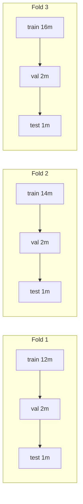
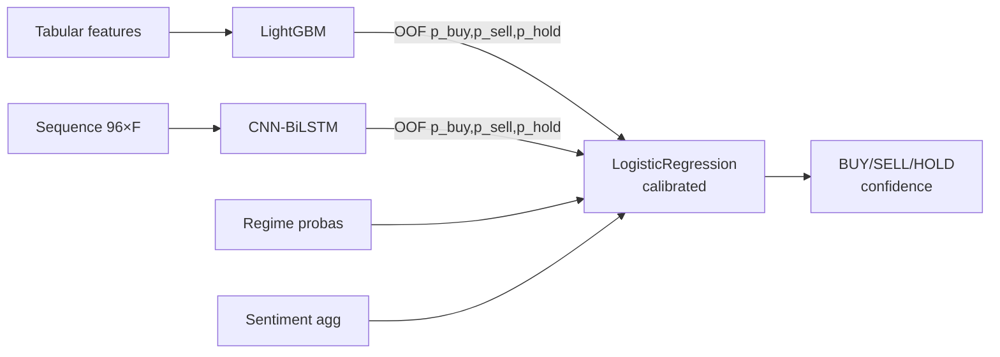
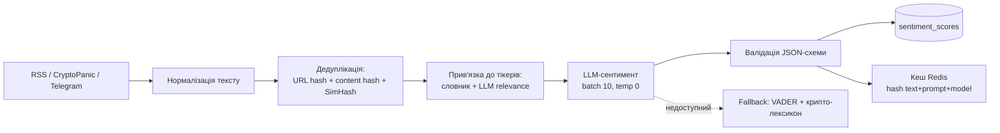

# FinSight AI — ML-пайплайн та дослідницький план

Версія: 1.1 · Основна мова: Python 3.12 · Пакет: `services/ml` (`finsight_ml`)

---

## 1. Постановка задачі

| Параметр | Рішення |
|---|---|
| Задача | Класифікація напрямку руху ціни на горизонті H барів: `BUY` / `SELL` / `HOLD` |
| Горизонт | 24 бари для 1h (доба), 5 барів для 1d (тиждень) |
| Додатковий вихід | Ціновий коридор (80% інтервал) на тому ж горизонті |
| Юніверс | 8–10 криптоактивів (BTC, ETH, SOL, BNB, XRP, ADA, AVAX, LINK) + 3–5 акцій/ETF (AAPL, MSFT, NVDA, SPY, QQQ) |
| Основні таймфрейми | 1h (основний), 1d (середньостроковий), 4h (допоміжний для узгодженості) |
| Дані | ≥ 24 місяці історії для 1h; ≥ 5 років для 1d |
| Валюта | USD/USDT; крос-курси не моделюються |

**Чому саме так:** горизонт 24 години дає достатньо руху, щоб перекрити комісію 0.1% + просковзування,
але ще не вимагає макроекономічного моделювання. Клас `HOLD` потрібен, бо більшість барів не дають
торговельної переваги — модель має вміти «мовчати».

---

## 2. Джерела даних та контроль якості

### 2.1. Джерела

| Дані | Джерело | Частота | Обмеження |
|---|---|---|---|
| OHLCV крипто | Binance REST + WebSocket | 1m live, історія з 2017 | Ліміти 1200 req/min (вагові) |
| OHLCV акції | Yahoo Finance (adjusted close) | 1d повна, 1h до 730 днів | Неофіційний API, можливі збої |
| Резерв акцій | Alpha Vantage free tier | 1d | 25 запитів/добу |
| Новини | RSS (CoinDesk, Cointelegraph, Reuters), CryptoPanic | 1–5 хв | Ключ CryptoPanic, ліміти |
| Telegram | Публічні канали (Telethon, read-only) | 1 хв | ToS, нестабільність |
| Сентимент | LLM через OpenRouter | батчами | Вартість, ліміти, доступність |

### 2.2. Контроль якості (data gates)

| Перевірка | Поріг | Дія при порушенні |
|---|---|---|
| Повнота 1h за період | ≥ 98% | Сегментація історії, виключення ділянок із тренування |
| Максимальний розрив | ≤ 3 бари | Розрив > 3 → новий сегмент; не склеювати |
| Монотонність часу | строго | Відхилити батч, алерт |
| OHLC-консистентність | `low ≤ o,c ≤ high` | Відхилити бар, лог |
| Дублікати | 0 | Upsert за ключем |
| Аномальні обсяги | z-score > 10 | Не видаляти, але прапор `volume_anomaly` |
| Корпоративні події (акції) | — | Використовувати adjusted close; спліти враховані джерелом |
| Сесії (акції) | — | Ознаки `session`, `bars_since_prev`, `overnight_gap`; не вважати нічний геп одним баром |

**Розриви для акцій — норма** (ночі, вихідні). Для крипто — аномалія. Це відображається в ознаках
`is_session_start`, `gap_bars`, і в стратегії бектесту (не входити в останній бар сесії).

### 2.3. Оцінка обсягу

| Набір | Рядків | Розмір |
|---|---|---|
| 10 крипто × 3 роки × 1h | ~263 тис. | ~30 МБ |
| 10 крипто × 3 роки × 1m (сировина) | ~15.8 млн | ~2–4 ГБ (стиснено) |
| 10 крипто × 3 роки × 1h + ознаки (Parquet) | ~263 тис. × 80 ознак | ~250 МБ |
| 5 акцій × 5 років × 1d | ~6.3 тис. | < 5 МБ |

---

## 3. Feature engineering

### 3.1. Групи ознак

| Група | Ознаки (приклади) | Кількість |
|---|---|---|
| Дохідності | `logret_1,3,6,12,24`, `cumret_24`, `zscore_price_ema50` | 8 |
| Тренд | `ema20/50/200`, `ema_ratio_20_50`, `ema_ratio_50_200`, `macd, macd_signal, macd_hist`, `adx14`, `ema_slope_20` | 10 |
| Моментум | `rsi14`, `rsi_divergence`, `roc_6`, `roc_24`, `stoch_k`, `stoch_d` | 6 |
| Волатильність | `atr14_norm`, `bb_width`, `realized_vol_24/72/168`, `parkinson_vol_24`, `vol_ratio_24_168`, `garman_klass_24` | 8 |
| Обсяг | `obv_slope_24`, `volume_zscore_24`, `vwap_dev`, `taker_buy_ratio`, `volume_trend` | 6 |
| Мікроструктура | `trade_count_z`, `avg_trade_size`, `high_low_range_norm`, `close_location_value` | 4 |
| Режим (HMM) | `p_bull, p_bear, p_range, p_high_vol`, `regime_duration`, `regime_entropy` | 6 |
| Аномалії | `if_score`, `is_anomaly` | 2 |
| Сентимент | `senti_6h, senti_24h, senti_72h`, `news_count_24h`, `senti_dispersion`, `senti_novelty`, `senti_source_trust` | 7 |
| Крос-активні | `corr_btc_24`, `btc_return_24`, `eth_btc_ratio_change`, `market_return_24`, `relative_strength_24` | 5 |
| Календар | `hour_sin/cos`, `dow_sin/cos`, `session_asia/eu/us`, `is_weekend` | 6 |
| Якість | `data_age_sec`, `gap_bars`, `stale_news` | 3 |

Разом ~70–80 ознак. Точний перелік — у `finsight_ml/features/registry.py` з полями
`name, dtype, lookback, description, version`.

### 3.2. Правила

1. **Стаціонарність.** Ціни не подаються як ознаки; лише логарифмічні дохідності
   `r_t = ln(P_t / P_{t-1})` та відносні величини. Абсолютні рівні — тільки для інтерпретації.
2. **Вікна — тільки назад.** Усі rolling-операції з `min_periods`, без `center=True`, без `shift(-1)`.
3. **Нормування.** Для дерев — не потрібне; для нейромереж — `RobustScaler`/`StandardScaler`,
   **fit лише на train-фолді**, збережений у артефакті.
4. **Кліппінг.** Дохідності winsorize на 0.1/99.9 перцентилях train-фолду; екстремальні барами
   позначаються прапорцем, а не видаляються.
5. **Sentiment leakage.** Агрегат новин бере лише `available_at ≤ t_close` (live: `ingested_at`; бекфіл: `published_at + 5 хв`, див. 02 §5.1).
6. **Календарні ознаки** — циклічне кодування (sin/cos), без монотонного номера години.
7. **Відсутні значення.** Не заповнюємо нулем: для дерев — `NaN` (LightGBM обробляє), для NN —
   індикатор пропуску + медіана train-фолду.
8. **Версіонування.** Будь-яка зміна ознак → нова версія `feature_set` і новий `schema_hash`;
   старі моделі лишаються відтворюваними.

### 3.3. Реалізація

```python
# finsight_ml/features/pipeline.py
class FeaturePipeline:
    def __init__(self, registry: FeatureRegistry, version: str): ...
    def compute(self, bars: pd.DataFrame, context: FeatureContext) -> pd.DataFrame:
        """bars: лише закриті бари, індекс — open_time UTC, відсортований."""
        ...
```

- Векторизований pandas/numpy; без циклів по барах.
- Один і той самий код для навчання і сервінгу (parity-тест на golden fixture).
- Продуктивність: повний перерахунок 3 років 1h для одного активу ≤ 1 с.
- Індикатори — власна векторизована реалізація (`indicators.py`), перевірена проти `ta`/TA-Lib на golden-даних (допуск 1e-6); runtime-залежності від TA-Lib немає.

### 3.4. Режими ринку та аномалії (деталі)

**HMM (4 стани):**

- Ознаки: `logret_1`, `realized_vol_24`, `volume_zscore_24`, `rsi14`; стандартизація лише на train.
- `covariance_type='full'`, `n_iter=200`, 5 рестартів; вибір за likelihood на val-фолді.
- Навчання: глобальний проксі (BTCUSDT для крипто, SPY для акцій) + опційно окрема модель на актив.
- Мапінг станів: сортування за (середня дохідність, волатильність) → `bull / bear / range / high_vol`;
  мапінг фіксується в артефакті, щоб уникнути label switching.
- **Онлайн-ознаки — лише filtered probabilities (forward algorithm)**, а не smoothed `predict_proba`:
  останній використовує майбутні спостереження і створює витік. У бектесті — та сама фільтрація
  по ковзному вікну.
- Вихід: 4 ймовірності, тривалість режиму, ентропія розподілу.

**Isolation Forest:**

- Ознаки: `|logret|`, `volume_zscore_24`, `range/ATR`, `trades_z`.
- Fit на train-вікні, `contamination=0.01`, перетренування щомісяця.
- Score нормалізується за квантилями train; у признаки — score + бінарний прапорець (поріг = 99-й перцентиль).
- Аномалії **не видаляються** з даних, лише позначаються — інакше втрачаються справжні шоки.

---

## 4. Розмітка: Triple Barrier + мета-лейбли

### 4.1. Алгоритм

Для кожного бару `t`:

```
σ_t   = EWMA(std(logret), span=24)              # або ATR14/close
upper = +k · σ_t · sqrt(H)                       # k = 2.0
lower = −k · σ_t · sqrt(H)
vertical = t + H                                 # H = 24 для 1h

для j = 1..H:
    якщо high[t+j] ≥ P_t·exp(upper) → BUY,  вихід за upper
    якщо low[t+j]  ≤ P_t·exp(lower) → SELL, вихід за lower
інакше → HOLD (вихід за ціною t+H)
```

Правила:

- **Порядок торкання в межах одного бару** визначається за 1m-даними (якщо доступні), інакше —
  консервативно: спочатку `lower` (песимістичне припущення для long).
- **Мінімальна ширина бар'єра:** `k·σ·sqrt(H) ≥ 2·fee + slippage = 0.003` (30 bps). Інакше семпл
  не маркується як торговельний (HOLD) — інакше модель вчиться ловити шум, який з'їдає комісія.
- **Ваги семплів:** середня унікальність (average uniqueness) за López de Prado для перекритих
  горизонтів + балансування класів.
- **Хвіст:** останні H барів не мають мітки і виключаються.
- **Збереження:** `labels(instrument_id, timeframe, as_of, label, exit_price, exit_reason, t1, barrier_up, barrier_down)` —
  окрема таблиця/Parquet, не змішується з ознаками.

### 4.2. Чому не просте «завтра вгору/вниз»

- Фіксований горизонт без бар'єрів дає нереалістичні мітки: ціна могла спочатку впасти на 5%, а потім
  вирости — трейдер би вийшов по стопу.
- Triple barrier враховує **шлях**, а не лише точку призначення, і безпосередньо відповідає логіці
  стоп-лос/тейк-профіт.
- Клас `HOLD` виникає природно, а не штучним порогом.

---

## 5. Валідація: purged walk-forward



| Параметр | Значення |
|---|---|
| Схема | Expanding window (розширюване тренувальне вікно) |
| Train / Val / Test | 12 / 2 / 1 місяць, крок 1 місяць |
| Purge | Видалити train-семпли, чий горизонт мітки перетинає початок val/test |
| Embargo | 24 бари (H) після тесту перед наступним train |
| Масштабність | 5–8 фолдів на актив; агрегація метрик по фолдах |
| Нормування | Fit scaler лише на train |
| Відбір ознак | Лише на train (importance / correlation), не на повному наборі |
| Стекові ознаки (HMM, Isolation Forest) | Навчаються **окремо в кожному фолді** лише на train; для val/test `p_*` та `if_score` рахуються фільтрацією. Режими, пораховані одним проходом по всьому датасету, — витік |

**Заборонено:** `train_test_split(shuffle=True)`, KFold без purge, підбір гіперпараметрів на test,
заповнення пропусків статистиками з усього датасету, відбір ознак за кореляцією з цільовою на повних даних.

Автоматичний тест `tests/ml/test_no_leakage.py`:
- перевіряє, що для кожного семплу `max(available_at ознак) ≤ as_of`;
- перевіряє, що жоден індекс train не перетинається з test;
- перевіряє, що scaler статистики не змінюються при додаванні майбутніх даних.

---

## 6. Моделі

### 6.1. Рівень 0 — baseline (обов'язковий)

| Модель | Призначення |
|---|---|
| Majority class | Санітарний мінімум |
| Logistic Regression (5–8 ознак) | Лінійний baseline, інтерпретованість |
| Random Forest | Перевірка нелінійності |

Baseline фіксується до експериментів; усі подальші моделі порівнюються з ним на тих самих фолдах.

### 6.2. Рівень 1a — LightGBM (tabular)

```yaml
objective: multiclass
num_class: 3
learning_rate: 0.03
num_leaves: 31
n_estimators: 2000
min_data_in_leaf: 100
feature_fraction: 0.8
bagging_fraction: 0.8
bagging_freq: 1
lambda_l2: 1.0
class_weight: balanced
early_stopping_rounds: 100
metric: multi_logloss
```

- Вхід: ~80 табличних ознак на бар `t`.
- Optuna (stretch): 40 trials, лише на val-фолдах.
- Інтерпретація: SHAP top-10 для кожного прогнозу (для UI `explanation`).

### 6.3. Рівень 1b — 1D-CNN + BiLSTM + Attention (sequence)

```
Input (96, F)
 → Conv1d(F→64, k=3) → BatchNorm → GELU → Conv1d(64→64, k=3) → BatchNorm → GELU
 → MaxPool(2)
 → BiLSTM(hidden=64, layers=1, dropout=0.2)
 → Attention pooling (additive)
 → Dropout(0.2) → Linear(→3)
```

| Гіперпараметр | Значення |
|---|---|
| Вікно | 96 барів (4 доби для 1h) |
| Batch | 128 |
| Optimizer | AdamW, lr 1e-3, weight decay 1e-4 |
| Scheduler | Cosine annealing, warmup 5% |
| Epochs | до 60, early stopping 10 |
| Loss | CrossEntropy + class weights |
| Регуляризація | dropout 0.2, grad clip 1.0 |
| Сіди | 3 (усереднення ймовірностей) |
| Пристрій | CPU (мала модель) або Colab GPU |

**PatchTST (stretch, дослідницька частина):** patch length 16, stride 8, d_model 64, 4 heads, 3 шари.
Порівнюється з CNN-BiLSTM, але не є обов'язковим для захисту.

### 6.4. Рівень 2 — meta-ensemble



- **Критично:** meta-модель навчається лише на **out-of-fold** передбаченнях рівня 1. Інакше —
  витік і оптимістичні метрики. Для часового ряду OOF-прогнози рівня 1 отримуються внутрішнім expanding walk-forward усередині train-фолду; ранній відрізок без OOF у навчанні meta не використовується.
- Вхід meta: 6 ймовірностей + 4 режими + 3 сентимент-ознаки + волатильність + `active_model_flags`.
- Модель: `LogisticRegression(C=1.0, class_weight='balanced')` або маленький LightGBM (порівняти).
- Калібрування: ізотонічна регресія на val-фолді (або temperature scaling для NN). Якщо val < 1000
  семплів — Platt scaling: ізотонічна регресія на малих вибірках перенавчається.
- Правило сигналу: `argmax(p)`; `HOLD`, якщо `max(p) < 0.55` або `p_buy − p_sell` < 0.10.
- Впевненість у UI = калібрована `max(p)`, а не «сира».

### 6.5. Ціновий коридор

Два підходи, обидва реалізуються та порівнюються:

1. **Conformal (основний).** На OOF-залишках логарифмічної дохідності за H барів беремо 10-й і 90-й
   перцентилі → інтервал; ціна = `P_t · exp(q10/q90)`. Дає емпіричне покриття ≈ 80% без припущень
   про розподіл.
2. **Quantile LightGBM.** Три моделі з `objective='quantile'`, α = 0.1/0.5/0.9 на дохідність.

Метрика: емпіричне покриття (ціль 0.78–0.82), середня ширина інтервалу (менше — краще), coverage
по класах. У дипломі — таблиця «покриття vs ширина» для обох методів.

---

## 7. Метрики та критерії приймання

### 7.1. Класифікація

| Метрика | Навіщо |
|---|---|
| Macro-F1 | Основний, стійкий до дисбалансу |
| Balanced accuracy | Додаткова |
| MCC | Одна цифра якості при 3 класах |
| Per-class precision/recall | Чи не «мовчить» модель постійно |
| Log loss | Якість ймовірностей |
| Brier score (multiclass) | Калібрування |
| ECE (10 bins) | Калібрування для UI-впевненості |
| Confusion matrix | Помилки BUY↔SELL (найдорожчі) |

### 7.2. Торговельна якість (після комісій)

| Метрика | Визначення |
|---|---|
| Coverage | Частка барів із сигналом ≠ HOLD |
| Hit rate | Частка прибуткових угод |
| Profit factor | Gross profit / gross loss |
| Sharpe (annualized) | `mean(daily_ret)/std(daily_ret)·√365` (крипто) або `√252` (акції) |
| Sortino | Те саме з downside deviation |
| Max drawdown | Максимальна просадка equity |
| Turnover | Кількість угод / період |
| Alpha vs buy&hold | Різниця Sharpe і доходності |
| Fee drag | Частка доходності, з'їдена комісіями |

### 7.3. Критерії приймання (фіксуються до експериментів)

| ID | Критерій | Поріг |
|---|---|---|
| A1 | Відсутність витоку | Усі leakage-тести зелені; ручний рев'ю ознак |
| A2 | Перевага над baseline | Macro-F1 ≥ baseline + 0.05 на ≥ 4 з 5 фолдів |
| A3 | Торговельна цінність | Sharpe після комісій > 0 на агрегаті OOF; > buy&hold у ≥ 50% фолдів |
| A4 | Калібрування | ECE ≤ 0.05 |
| A5 | Коридор | Покриття 80% інтервалу в межах 0.75–0.85 |
| A6 | Продуктивність | p95 інференсу ≤ 500 мс на CPU |
| A7 | Відтворюваність | Повторний запуск із тим самим `dataset_hash` дає ті самі метрики (±1e-4) |

**Якщо A2/A3 не досягнуто — це чесний результат дослідження**, а не привід підганяти. У дипломі
аналізуються причини (недостатньо даних, шум, транзакційні витрати) і пропонуються напрями покращення.
Це сильніше виглядає на захисті, ніж підозріло високі метрики.

**Дослідницька дисципліна:** гіпотези, метрики та пороги фіксуються до запуску; заборонено підбирати
гіперпараметри або пороги сигналу на тестових фолдах; звітуються всі 12 експериментів, включно з
невдалими. Для контролю множинних порівнянь основні результати супроводжуються bootstrap-довірчими
інтервалами (1000 ресемплів), а не однією цифрою.

---

## 8. Walk-forward бектестинг

### 8.1. Правила (без look-ahead)

1. Сигнал обчислюється на **закритті** бару `t` з даних `≤ t`.
2. Виконання — на **відкритті** бару `t+1`.
3. Комісія 10 bps на сторону, просковзування 5 bps; разом 30 bps на round-trip.
4. Long/flat (спот); шорт — лише як налаштування для акцій, за замовчуванням вимкнено.
5. Розмір позиції: фіксована частка капіталу (10%) або vol-targeting (ризик 1% на угоду).
6. Виходи за замовчуванням ті самі, що в розмітці: бар'єри ±k·σ_t·√H і вертикальний бар'єр H (для 1h — 24). Інакше модель навчена передбачати одну подію, а бектест оцінює іншу. Варіант `atr_stops` (ATR-стоп 2.5, ATR-тейк 4.0, максимум 72 бари) — окремий експеримент, що явно позначається у звіті.
7. Один інструмент — одна відкрита позиція; без плеча.
8. Mark-to-market щоденного equity; бенчмарк — buy&hold того ж активу.
9. Перетренування в режимі `walk_forward_retrain`: кожні 30 днів на розширюваному вікні.
10. Метрики рахуються на **out-of-sample** ділянках; агрегація — по всіх фолдах.

### 8.2. Два режими

| Режим | Що робить | Час | Для чого |
|---|---|---|---|
| `static_model` | Одна модель на весь період | 1–2 хв | Швидка перевірка, курсова |
| `walk_forward_retrain` | Перетренування кожні 30 днів | 30–120 хв | Диплом, доказова частина |

### 8.3. Артефакти бектесту

- `metrics.json` — усі метрики + метрики по фолдах.
- `equity.parquet` — крива капіталу, drawdown, benchmark.
- `trades.parquet` — усі угоди з причинами виходу.
- `report.pdf` — графіки + таблиці (для диплома).
- `config.yaml` — точний конфіг запуску (відтворюваність).

---

## 9. Реєстр моделей і сервінг

### 9.1. Артефакт моделі

```
s3://models/{name}/{semver}/
├── model.txt / model.pt        # ваги
├── preprocess.json             # scaler, кліпінг, порядок ознак
├── feature_schema.json         # імена, dtype, lookback, версія
├── metrics.json                # CV + test + per-fold
├── config.yaml                 # гіперпараметри
├── dataset_manifest.json       # файли, розміри, хеші
└── model_card.md               # призначення, обмеження, автор, дата
```

`dataset_hash = sha256(json.dumps(manifest, sort_keys=True))`.

### 9.2. Життєвий цикл

`candidate` → (ручний review) → `production` → `archived`.
Промотування через API/CLI з обов'язковим переглядом метрик; публікується Redis-подія
`model.promoted`, воркери перезавантажують модель без рестарту.

### 9.3. Сумісність train/serve

- Єдина функція `FeaturePipeline.compute` для обох шляхів.
- Golden fixture: 500 барів → очікуваний вектор (JSON); тест порівнює train та serve з точністю 1e-6.
- Порядок ознак фіксується в `feature_schema.json`; модель відмовляється працювати при розбіжності
  `schema_hash` (краще 503, ніж тихо неправильний прогноз).

### 9.4. Моніторинг

| Метрика | Поріг алерту |
|---|---|
| PSI ознак (тижневе вікно vs train) | > 0.25 |
| Частка сигналів BUY/SELL | відхилення > 20 в.п. від train |
| ECE на нових даних (після появи міток) | > 0.08 |
| Inference latency p95 | > 500 мс |
| Частка `MODEL_NOT_READY` | > 1% запитів |

Щоденний звіт `model_monitoring`; графік у Grafana/дашборді.

---

## 10. NLP-модуль

### 10.1. Конвеєр



### 10.2. Prompt-контракт (спрощено)

```json
{
  "score": -1.0,
  "confidence": 0.0,
  "relevance": 0.0,
  "event_type": "regulation|hack|partnership|macro|listing|other",
  "horizon": "short|medium|long",
  "tickers": ["BTC"],
  "rationale": "one sentence"
}
```

- `temperature=0`, `response_format=json_schema`, повторна валідація Pydantic.
- Батч 10 заголовків + коротких описів; кеш за `sha256(text + prompt_version + model)`.
- Моделі: дешева (DeepSeek/Qwen) для масового потоку, Gemini — для асистента.
- Вартість: ~1000 новин/доба × 300 токенів ≈ 0.3 млн токенів/доба; при $0.2–0.5/млн — $2–5/місяць.
- Ліміт бюджету: `LLM_DAILY_BUDGET_USD`; при перевищенні — лише кеш і fallback.

### 10.3. Оцінка якості LLM-сентименту

- Власний золотий набір: 250 новин, розмічених вручну за шкалою -1..+1 (2 розмітники, розбіжності — консенсус).
- Метрики: MAE, Cohen's κ (бінарна полярність), precision/recall для «сильних» новин (|score| ≥ 0.5).
- Порівняння: LLM vs VADER vs FinBERT (якщо доступний).
- Абляція: модель із сентиментом vs без — внесок у Macro-F1 і Sharpe. Це ключовий слайд диплома.

---

### 10.4. Історія новин та схема фолдів для E3/E11

Реальної історії новин з `ingested_at` на старті немає (збір починається в C1, 23.11.2026). Тому:

1. Збір сирого тексту RSS/CryptoPanic запускається в C1 і працює безперервно.
2. Для історичного бекфілу шукається публічний датасет новин (Kaggle/Hugging Face, GDELT; ліцензії перевірити). Записи отримують `availability_basis='backfill_published_proxy'`.
3. Схема фолдів 12/2/1 для сентименту непридатна. E3 виконується на періоді з покриттям новин за скороченою схемою (train 3 міс. / val 1 / test 1, 2–3 фолди) з bootstrap-довірчими інтервалами; результат трактується як попередній, а не як остаточне доведення.
4. Результати live і backfill звітуються окремо (див. 02 §5.1 про lookahead LLM).
5. Рішення про схему фіксується до запуску експерименту (дослідницька дисципліна, розділ 7.3).

## 11. План експериментів (для диплома)

| ID | Гіпотеза | Порівняння | Метрики | Розділ |
|---|---|---|---|---|
| E1 | Нелінійна модель краща за лінійну | LogReg vs LGBM | Macro-F1, MCC | 3 |
| E2 | Технічні ознаки достатні | feature ablation: trend/momentum/vol/volume | Δ Macro-F1 | 3 |
| E3 | Сентимент додає цінність | з/без sentiment-ознак | Δ Macro-F1, Δ Sharpe | 3 |
| E4 | Режим ринку покращує сигнал | з/без HMM-ознак, з/без gating | Δ Sharpe, coverage | 3 |
| E5 | Sequence-модель краща за tabular | LGBM vs CNN-BiLSTM | Macro-F1, Sharpe | 3 |
| E6 | Ансамбль кращий за кожну модель | LGBM / DL / meta | Macro-F1, ECE, Sharpe | 3 |
| E7 | Калібрування покращує рішення | raw vs calibrated | ECE, precision@0.7 | 3 |
| E8 | Інтервали адекватні | conformal vs quantile | coverage, width | 3 |
| E9 | Walk-forward реалістичніший | static vs retrain | Sharpe, MaxDD, turnover | 4 |
| E10 | Витрати критичні | fee 0 / 0.1 / 0.2% | Sharpe, fee drag | 4 |
| E11 | LLM-сентимент узгоджується з людиною | LLM vs VADER vs human | MAE, κ | 4 |
| E12 | Система витримує навантаження | load test | p95, RPS, помилки | 4 |

Кожен експеримент: конфіг у `configs/experiments/E0X.yaml`, результат — JSON + таблиця + графік,
відтворюваний одною командою `just experiment E03`.

---

## 12. Обчислювальні оцінки

| Етап | CPU | GPU (Colab) |
|---|---|---|
| Feature pipeline, 10 активів × 3 роки | 3–5 хв | — |
| LGBM, один фолд | 1–2 хв | — |
| CNN-BiLSTM, один фолд | 10–25 хв | 2–4 хв |
| Повний дослід (E1–E9, 5 фолдів) | 6–12 год | 2–3 год |
| Walk-forward бектест, 12 місяців, retrain | 30–90 хв | 10–20 хв |
| Інференс на бар | < 50 мс | — |

Планування: важкі експерименти — нічними прогонами на локальній машині; Colab — для DL-сітки.

---

## 13. Ризики ML-частини

| Ризик | Ознака | Дія |
|---|---|---|
| Витік даних | «Занадто добрі» метрики (> 70% accuracy) | Негайно перевірити leakage-тести, часові зсуви, scaler |
| Дисбаланс класів | HOLD > 70% | Ваги, пороги, окрема оцінка coverage |
| Недостатньо даних | < 12 місяців на актив | Виключити актив або перейти на 1d |
| Перенавчання на фолді | Розкид Sharpe між фолдами > 2× | Більше регуляризації, менше ознак, ансамбль сідів |
| Комісія з'їдає прибуток | Fee drag > 50% | Вищий поріг входу, довший горизонт, менше угод |
| Нереалістичний бектест | Sharpe > 3 | Перевірити виконання на next open, slippage, ліквідність |
| LLM-сентимент нестабільний | Низька κ з людиною | Фіксувати модель і prompt_version, кешувати, fallback |
| Немає історії новин / lookahead LLM | Ablation E3 недоказовий | Окремі звіти live vs backfill, скорочена схема фолдів, чесне обмеження (10.4) |
| Дрейф моделі | PSI > 0.25 | Перетренування, моніторинг, алерт |

---

## 14. Модельна картка (обов'язковий артефакт)

Кожна production-модель супроводжується `model_card.md`:

- Призначення та горизонт; юніверс і таймфрейм.
- Дата навчання, `dataset_hash`, версія ознак.
- Метрики по фолдах (mean ± std), калібрування, покриття інтервалів.
- Обмеження: не для реальних інвестиційних рішень; не враховує макро-події, ліквідність, funding.
- Етичні застереження: не є інвестиційною рекомендацією; демонстраційний характер.
- Відомі режими відмови: різкі новинні шоки, зупинки торгів, низька ліквідність.
