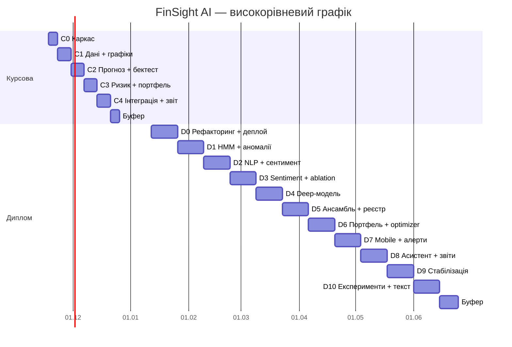

# FinSight AI — План розробки

Версія: 1.1 · Дата: 2026-11-17 · Горизонт: курсова (грудень 2026) → диплом (червень 2027)

---

## 0. Припущення та як читати план

| Припущення | Значення | Як змінити |
|---|---|---|
| Виконавець | 1 розробник (студент) + науковий керівник | Якщо команда 2+ — паралелити mobile/ML |
| Доступний час | 25–30 год/тиждень, ~3 дні/тиждень | Менше 20 год → скорочення за розділом 2.3 |
| Ємність курсової | 18.11–25.12 ≈ 5,5 тижня ≈ 17–19 людино-днів | Пакет S оцінено в ~19 днів; зазор закриває «мінімум курсової» (3.2) |
| Захист курсової | 3-тя декада грудня 2026 | Якщо січень — додається 2 тижні буферу |
| Захист диплома | кінець червня 2027 | — |
| Оцінки | у людино-днях (8 год), з урахуванням AI-асистенції в коді | — |

**Головна теза плану:** повний обсяг зі специфікації — це ~140–160 людино-днів, що **не вміщається**
в ~92 робочі дні + 2 тижні буферу. Тому план побудований навколо вертикального ядра, яке дає захист
курсової вже в грудні, а диплом нарощує дослідницьку частину. Усе, що не входить, явно позначене
як stretch і має пріоритет скорочення.

---

## 1. Огляд етапів

---

## 2. Скоуп: три пакети та бюджет

### 2.1. Пакети

| Пакет | Призначення | Ємність | Входить |
|---|---|---|---|
| **S — Курсова** | Вертикальний зріз, доводить працездатність | ~19 днів | Дані (beat-опитування), індикатори, desktop-графіки (web-версія), LGBM-прогноз, бектест, базовий ризик, звіт. Без streamer, MinIO, Tauri-обгортки, auth |
| **D — Диплом** | Дослідницька новизна + повноцінний продукт | ~75 днів | HMM, аномалії, NLP-сентимент, deep-модель, ансамбль, портфельний оптимізатор, mobile, алерти, асистент, експерименти |
| **C — Stretch** | Якщо залишився час | ~15 днів | PatchTST, Optuna, PDF-звіти, повний CRUD у mobile, мультибіржовість, Grafana |

### 2.2. Бюджет за епіками

| # | Епік | S | D | C | Пріоритет |
|---|---|---:|---:|---:|---|
| 1 | Monorepo, CI, Docker, БД | 2 | — | — | Must |
| 2 | Інгестія даних + якість (D: streamer) | 3 | 2 | 1 | Must |
| 3 | Ознаки + індикатори | 2 | 2 | 1 | Must |
| 4 | API core + auth | 2 | 3 | — | Must (S — без auth) |
| 5 | Desktop: графіки (D: Tauri-обгортка) | 3 | 3 | 1 | Must |
| 6 | Desktop: дашборди | 1 | 2 | 1 | Should |
| 7 | Розмітка + бектест | 3 | 3 | 1 | Must |
| 8 | LGBM + оцінка | 1 | 2 | — | Must |
| 9 | HMM + аномалії | — | 5 | 1 | Should (D) |
| 10 | NLP + сентимент | — | 6 | 1 | Should (D) |
| 11 | Deep-модель | — | 6 | 2 | Could (D, але потрібна для новизни) |
| 12 | Ансамбль + калібрування | — | 4 | 1 | Should (D) |
| 13 | Ризик + портфель | 1 | 3 | — | Must |
| 14 | Оптимізатор Марковіца | — | 4 | 1 | Could |
| 15 | Mobile | — | 8 | 2 | Should |
| 16 | Алерти + push | — | 3 | — | Could |
| 17 | AI-асистент | — | 2 | 1 | Could |
| 18 | Звіти PDF/CSV | — | 1 | 1 | Could |
| 19 | Деплой + моніторинг | — | 3 | — | Should |
| 20 | Тести + хардненінг | 1 | 3 | — | Must |
| 21 | Диплом: експерименти + текст | — | 12 | — | Must |
| **Разом** | | **~19** | **~77** | **~15** | |

> Сума S+D ≈ 96 днів ≈ 92 робочі дні + 2 тижні буферу. Це верхня межа; буфер закладено в календарі,
> а не в оцінках. Якщо ємність 20 год/тиждень — виконуємо S повністю, а з D лишаємо HMM, NLP,
> ансамбль, mobile-read-only; оптимізатор і асистент — у «майбутню роботу».

### 2.3. Порядок скорочення (scope guard)

Якщо на контрольній точці відставання > 1 тиждень — ріжемо **в такому порядку**:

1. AI-асистент (залишити заглушку в UI).
2. PDF-експорт (замінити на CSV).
3. Оптимізатор у UI (API лишити, екран — таблиця ваг).
4. Push-алерти (лишити in-app).
5. Deep-модель (замінити на порівняння LGBM vs baseline; novelty змістити на сентимент + режими).
6. Mobile до 3 екранів (сигнал, графік, дайджест).
7. Mobile повністю — **лише як крайній захід**, це вимога специфікації.

**Не ріжемо ніколи:** бектест із комісіями, risk-метрики, desktop-графіки, розділ експериментів,
документацію та відтворюваність.

---

## 3. Курсова робота (18 листопада — 25 грудня 2026)

### 3.1. Спринти

#### C0. Каркас (18–22 листопада, 5 днів) · ~3 дні

| Задача | Результат |
|---|---|
| Monorepo: pnpm + Turborepo, `apps/desktop`, `packages/api-client`, `services/api` | `pnpm dev` піднімає порожній застосунок |
| Python: uv, `services/api`, `finsight_ml`, ruff/mypy/pytest | `uv run pytest` зелений |
| Docker Compose: postgres+timescale, redis (MinIO — з D0; артефакти на локальній ФС) | `docker compose up` → `/ready` ok |
| Alembic: перші таблиці `instruments`, `candles` | Міграція застосовується з нуля |
| Tauri + React + Vite + Tailwind, сторінка-заглушка | Вікно відкривається, запит `/health` працює |
| CI: lint, typecheck, tests, build | Зелений PR-чек |

**Віха M0:** «Каркас» — усе піднімається однією командою на чистій машині.

> Ризик: збірка Tauri на Windows (Rust, MSVC, WebView2) може з'їсти день. Не блокуватися — спочатку
> web-версія у Vite, Tauri-обгортка додається після M0.

#### C1. Дані та графіки (23–29 листопада, 7 днів) · ~4 дні

| Задача | Результат |
|---|---|
| `instruments` seed: BTCUSDT, ETHUSDT, SPY | 3 активи в БД |
| Binance/Yahoo адаптери + backfill 1h/1d за 2 роки + beat-опитування закритих барів раз на хвилину (streamer — з D0) | ≥ 98% повноти, `ingestion_runs` заповнені |
| API: `/instruments`, `/instruments/{id}/candles`, `/quote` | OpenAPI валідний, TS-клієнт згенеровано |
| Desktop: список активів, свічковий графік Lightweight Charts, перемикання TF | Графік 1h/1d з обсягами |
| Індикатори EMA20/50/200, RSI14, MACD (обчислення + API) | Накладання на графік toggle-ами |
| Data quality job: перевірка розривів | Звіт у `data_gaps` |
| RSS-збирач новин (лише сирий текст, без LLM; ~0,5 дня) | Історія накопичується з 23.11 для ablation (04 §10.4) |

**Віха M1:** «Живі дані» — реальні свічки на екрані, індикатори перемикаються.

#### C2. Перший прогноз і бектест (30 листопада — 6 грудня, 7 днів) · ~6 днів

| Задача | Результат |
|---|---|
| Feature pipeline v1 (~30 ознак: дохідності, тренд, моментум, волатильність, обсяг, календар; решта груп — з D) з тестами | `feature_sets` v1, point-in-time |
| Triple barrier labeling + датасет | Мітки 3 класів, звіт розподілу |
| LightGBM baseline + purged walk-forward (3 фолди) | Macro-F1, confusion matrix, калібрування |
| Backtest v0: next-open execution, fee 0.1%, виходи за бар'єрами розмітки (04 §8.1), equity curve | Sharpe, MaxDD, hit rate, profit factor |
| `POST /backtests`, `GET /predictions` | Прогноз із confidence + коридор |
| Desktop: overlay сигналу, панель «прогноз», екран бектесту | Демо-сценарій проходить |

**Віха M2:** «Перший прогноз» — модель дає сигнал, бектест показує криву капіталу.

> Це найризикованіший спринт курсової. Порядок робіт: triple barrier → бектест → LGBM → API →
> UI-накладання. Цифри для захисту важливіші за красивий overlay; якщо часу обмаль, overlay
> робиться статичним знімком.

#### C3. Ризик і портфель (7–13 грудня, 7 днів) · ~3 дні

| Задача | Результат |
|---|---|
| VaR 95% (historical), CVaR, Sharpe, Sortino, MaxDD, vol | `/portfolios/{id}/risk` |
| Портфель: 2 демо-позиції, PnL, ваги | Екран портфеля |
| Кореляційна матриця (90d, 1d) | Heatmap ECharts |
| HMM baseline (3 стани) на 1 активі — *опційно, перший кандидат на скорочення* | Поточний режим + ймовірності |
| Desktop: risk-панель, кореляції, режим | Дашборд заповнений |

**Віха M3:** «Курсова feature-complete» — усі 4 напрями (аналіз, ризик, BI, прогноз) видимі в UI.

#### C4. Інтеграція, тести, звіт (14–20 грудня, 7 днів) · ~3 дні

- E2E-сценарій: запуск → дані → прогноз → бектест → ризик.
- Виправлення багів, продуктивність (кеш свічок, індекси).
- Скріншоти, графіки, таблиці для пояснювальної записки.
- Текст курсової: 25–35 сторінок (структура — розділ 8).
- Презентація 10–12 слайдів + доповідь 5 хв.

**Віха M4 (25 грудня):** курсова готова, демо записано, код у репозиторії з тегом `v0.1.0-coursework`.

### 3.2. Мінімальний обсяг курсової (якщо часу обмаль)

Якщо до 10 грудня відставання > 5 днів — фіксуємо такий мінімум:

- 2 активи (BTC, ETH), 1h + 1d, 2 роки.
- Графік + 3 індикатори.
- LGBM-прогноз + коридор.
- Бектест із комісією + equity curve.
- VaR/Sharpe/MaxDD на демо-портфелі.
- Без HMM, без кореляцій, без мобільного.

Цього достатньо для позитивного захисту курсової; решта переноситься в диплом.

---

## 4. Дипломний проєкт (12 січня — 25 червня 2027)

### D0. Рефакторинг і production-ready (12–25 січня) · ~7 днів

- Виділення доменних модулів, прибрати технічний борг курсової.
- `market-streamer` (WS Binance, усі TF) замість beat-опитування; MinIO (`STORAGE_BACKEND=s3`); Tauri-обгортка над web-версією.
- Auth: JWT + refresh rotation, ролі; міграція демо-даних на `user_id`.
- Деплой на VPS: Caddy, compose, healthchecks, бекапи, staging.
- Моніторинг: structlog, Prometheus-метрики, алерт у Telegram.
- OpenAPI-контракт заморожено, `v1` стабільна.

**M5 (1 лютого):** система доступна за HTTPS, дані оновлюються автоматично, є staging.

### D1. Режими ринку та аномалії (26 січня — 8 лютого) · ~5 днів

- HMM: 4 стани, навчання на дохідностях+волатильності, впорядкування станів (label switching).
- Мапінг станів → `bull/bear/range/high_vol` за середньою дохідністю та волатильністю.
- Isolation Forest: ознаки обсягу/дохідності, contamination 1%, поріг, пояснення.
- API `/regime`, `/anomalies`; UI-бейджі та графік режимів.
- Gating: блокування сигналів у `high_vol` (конфігуровано).

**M6 (8 лютого):** режим і аномалії в UI, вплив gating виміряно на бектесті.

### D2. NLP-конвеєр (9–22 лютого) · ~7 днів

- RSS + CryptoPanic + Telegram (2 канали), нормалізація, дедуплікація (URL/content/SimHash).
- Прив'язка до тікерів: словник + LLM relevance.
- LLM-сентимент: JSON-схема, батчі, кеш, `llm_usage`, бюджет.
- Fallback VADER/лексикон; `DEMO_MODE` віддає записані оцінки.
- UI: стрічка новин, фільтри за сентиментом, бейджі, графік «настрій vs ціна».
- Золотий набір 250 новин для оцінки (ручна розмітка — розподілити на 2 тижні).
- Бекфіл історії з публічного датасету (перевірити ліцензію) з `availability_basis='backfill_published_proxy'`.

**M7 (22 лютого):** стрічка новин із сентиментом, графік кореляції, оцінка κ готова.

### D3. Сентимент в ознаках + ablation (23 лютого — 8 березня) · ~5 днів

- Агрегати `senti_6h/24h/72h`, dispersion, novelty; feature_set v2.
- Перетренування LGBM, ablation E3/E11, аналіз внеску. E3 — на періоді з покриттям новин за скороченою схемою фолдів, live і backfill окремо (04 §10.4).
- Калібрування порогів сигналу з урахуванням нових ознак.
- Оновлення звіту експериментів.

**M8 (8 березня):** доведено (або спростовано) внесок сентименту — ключовий слайд диплома.

### D4. Deep-модель (9–22 березня) · ~7 днів

- Dataset вікон 96×F, PyTorch Dataset/DataLoader, seed control.
- 1D-CNN + BiLSTM + Attention, навчання на 3–5 активах, 3 сіди.
- Ridge/LGBM-порівняння, метрики, криві навчання.
- Інтеграція в інференс як друга модель (поки без ансамблю).

**M9 (22 березня):** deep-модель навчена й оцінена на тих самих фолдах, що й LGBM.

### D5. Ансамбль, калібрування, інтервали (23 березня — 5 квітня) · ~5 днів

- OOF-передбачення обох моделей, meta-класифікатор.
- Калібрування (isotonic/temperature), ECE.
- Conformal-інтервали + quantile LGBM, порівняння покриття.
- Реєстр моделей: артефакти, `dataset_hash`, промотування, model card.
- Пояснення (SHAP top-5) у відповіді API.

**M10 (5 квітня):** meta-ensemble у production, калібровані ймовірності, інтервали покриті ~80%.

### D6. Портфель і оптимізатор (6–19 квітня) · ~7 днів

- Транзакції, точний PnL, історія, звірка позицій.
- Коваріація Ledoit-Wolf, mean-variance з обмеженнями (long-only, max weight 30%, sum=1).
- SLSQP-оптимізація, ефективна межа, точка поточного портфеля.
- UI: конструктор портфеля, heatmap кореляцій, frontier, VaR/Sharpe.
- E9/E10: walk-forward vs static, чутливість до комісій.

**M11 (19 квітня):** портфельний модуль повний, оптимізатор дає пояснювані ваги.

### D7. Mobile + алерти (20 квітня — 3 травня) · ~10 днів

- Expo: auth (secure-store), 4 екрани: сигнали, графік, портфель, дайджест.
- Push: реєстрація токена, тихі години, deep-link на актив.
- Алерти: конструктор правил (3 шаблони), cooldown, історія.
- Мобільний графік 24г/7д/1м + бейдж впевненості.

**M12 (3 травня):** мобільний додаток у TestFlight/APK, push доходить до пристрою.

### D8. Асистент і звіти (4–17 травня) · ~5 днів

- SSE-чат, system prompt, 5 read-only інструментів, ліміт кроків.
- RAG по новинах/портфелю, цитати, дисклеймер.
- PDF-звіт (Jinja2 + Playwright/Chromium print-to-PDF; уникаємо GTK-залежностей WeasyPrint на Windows)
  для портфеля/бектесту, CSV-експорт.
- UI: чат на desktop, кнопка «пояснити сигнал».

**M13 (17 травня):** асистент відповідає з цитатами, звіт генерується.

### D9. Стабілізація (18–31 травня) · ~8 днів

- Навантажувальний тест (Locust/k6): 50 RPS читання, 10 WS-клієнтів.
- Безпека: перевірка ізоляції даних, rate limit, залежності, CSP.
- Виправлення знайденого, оптимізація запитів, індекси.
- UX-полірування, empty/error/loading states, accessibility.
- Документація: README, deployment guide, user guide.

**M14 (31 травня):** feature freeze; далі — лише експерименти, текст і виправлення критичних багів.

### D10. Експерименти та диплом (1–14 червня) · ~12 днів

- Прогін E1–E12, зведені таблиці, графіки (єдиний стиль).
- Розділ 3–4: реалізація, експерименти, обговорення, обмеження.
- Демо-відео 5–7 хв, резервний офлайн-сценарій.
- Репетиція захисту, підготовка відповідей на 20 типових питань.

**M15 (15 червня):** диплом готовий, тег `v1.0.0-thesis`.

---

## 5. Віхи та критерії приймання

| Віха | Дата | Критерій «готово» | Рішення при провалі |
|---|---|---|---|
| M0 Каркас | 22.11 | `docker compose up` + `pnpm dev` + CI зелені на чистій машині | 1 день на фікс, інакше спростити стек |
| M1 Дані | 29.11 | 3 активи, ≥ 98% повноти, графік з індикаторами | Зменшити до 2 активів |
| M2 Прогноз | 06.12 | Прогноз + бектест із комісією, метрики по фолдах | Спростити до 2 фолдів, лишити LGBM |
| M3 Курсова | 13.12 | Усі 4 блоки в UI, демо проходить | Застосувати мінімум курсової |
| M4 Здача | 25.12 | Текст + презентація + відео, тег `v0.1.0` | — |
| M5 Prod | 01.02 | HTTPS, автодані, staging, моніторинг | Відкласти Grafana, лишити логи |
| M6 Режими | 08.02 | HMM+IF у UI, gating виміряно | Спростити до 3 станів |
| M7 NLP | 22.02 | Стрічка + сентимент + κ | Fallback VADER як основне джерело |
| M8 Ablation | 08.03 | E3/E11 завершено, висновок зафіксовано | — |
| M9 Deep | 22.03 | Модель навчена, метрики на тих самих фолдах | Порівняти на 3 фолдах, 2 активах |
| M10 Ensemble | 05.04 | meta + калібрування + інтервали | Лишити LGBM+калібрування, deep — у майбутнє |
| M11 Портфель | 19.04 | Оптимізатор + frontier + PnL | Лишити API, UI спростити |
| M12 Mobile | 03.05 | 4 екрани + push | 3 екрани, без push |
| M13 Асистент | 17.05 | Чат із цитатами, звіт PDF | Заглушка «у майбутній роботі» |
| M14 Freeze | 31.05 | Тести зелені, навантаження пройдено | Лише критичні баги |
| M15 Диплом | 15.06 | Текст + відео + репетиція | Буфер до 25.06 |

---

## 6. WBS з оцінками (людино-дні)

| Епік | Задачі | Опт. | Ймов. | Песим. | Залежності |
|---|---|---:|---:|---:|---|
| E1 Інфраструктура | repo, CI, compose, міграції, seed | 3 | 4 | 6 | — |
| E2 Дані | адаптери, backfill, валідація, gaps, streamer | 5 | 6 | 9 | E1 |
| E3 Ознаки | індикатори, pipeline, registry, parity-тест | 4 | 5 | 7 | E2 |
| E4 API | роутери, схеми, auth, OpenAPI, генерація | 5 | 6 | 8 | E1 |
| E5 Desktop-графіки | shell, свічки, індикатори, realtime | 5 | 7 | 10 | E2,E4 |
| E6 Desktop-дашборди | портфель, ризик, кореляції, режими | 4 | 6 | 9 | E5 |
| E7 Розмітка+бектест | triple barrier, рушій, метрики, звіти | 6 | 9 | 13 | E3 |
| E8 LGBM | baseline, CV, SHAP, інтеграція | 4 | 5 | 7 | E7 |
| E9 HMM+IF | навчання, мапінг, API, gating | 3 | 5 | 7 | E3 |
| E10 NLP | інгестія, дедуп, LLM, кеш, UI | 5 | 7 | 10 | E4 |
| E11 Deep | dataset, модель, навчання, оцінка | 5 | 7 | 11 | E3 |
| E12 Ансамбль | OOF, meta, калібрування, інтервали, реєстр | 4 | 5 | 8 | E8,E11 |
| E13 Ризик+портфель | VaR, Sharpe, транзакції, PnL, звірка | 6 | 7 | 10 | E2 |
| E14 Оптимізатор | коваріація, SLSQP, frontier, UI | 3 | 4 | 6 | E13 |
| E15 Mobile | auth, 4 екрани, push, deep links | 8 | 10 | 14 | E4 |
| E16 Алерти | rule engine, cooldown, push, історія | 3 | 4 | 6 | E4,E10 |
| E17 Асистент | SSE, tools, RAG, цитати | 2 | 3 | 5 | E10,E13 |
| E18 Звіти | PDF, CSV, шаблони | 2 | 3 | 4 | E7,E13 |
| E19 Деплой | VPS, Caddy, бекапи, метрики, алерти | 4 | 5 | 7 | E1 |
| E20 Тести | unit, integration, e2e, load, security | 5 | 6 | 9 | усі |
| E21 Диплом | експерименти, текст, відео, репетиція | 12 | 14 | 18 | E7–E12 |
| **Разом** | | **98** | **128** | **184** | |

**Інтерпретація:** оптимістична сума — 98 днів, що на 2 дні більше за плановий бюджет (96 днів,
таблиця 2.2); цей день покривається календарним буфером. «Ймовірна» сума — 128 днів — **не
вміщається** в ємність. Отже, план виконується за оптимістично-реалістичним сценарієм, а резерв
створюється не оцінками, а скороченням функцій на контрольних точках (розділ 2.3).

---

## 7. Контрольні точки та процес

### 7.1. Тижневий ритм

| День | Активність |
|---|---|
| Понеділок | Планування тижня, перевірка свіжості даних, огляд метрик |
| Вівторок–четвер | Реалізація, тести, дрібні коміти |
| П'ятниця | Демо-прогін, оновлення документації, нотатки для диплома |
| Субота | 2 год: експерименти або текст розділу |
| Неділя | Вихідний (профілактика вигорання) |

### 7.2. Контрольні точки

| CP | Дата | Питання | Дія, якщо «ні» |
|---|---|---|---|
| CP1 | 10.12 | Відставання від плану < 5 днів? | Мінімум курсової (3.2); текст курсової пишеться паралельно |
| CP2 | 15.02 | NLP працює end-to-end? | VADER як основне, LLM — опційно |
| CP3 | 01.04 | Є порівняння моделей? | Лишити LGBM+meta, deep — у майбутнє |
| CP4 | 15.05 | Mobile + алерти готові? | 3 екрани, без push |
| CP5 | 01.06 | Feature freeze? | Тільки критичні баги + текст |

### 7.3. Definition of Done (для фічі)

- [ ] Код у `main` через PR, рев'ю (self-review чекліст).
- [ ] Unit-тести + типізація (mypy/tsc) зелені.
- [ ] Міграція БД (якщо є) + оновлення OpenAPI + регенерація клієнта.
- [ ] Працює на staging, перевірено вручну.
- [ ] Логи/метрики додані, помилки оброблені.
- [ ] Оновлена документація (ADR або розділ).
- [ ] Демо-крок доданий у сценарій захисту.

---

## 8. Структура пояснювальної записки

| Розділ | Зміст | Орієнтовний обсяг | Коли писати |
|---|---|---|---|
| Вступ | Актуальність, мета, задачі, об'єкт/предмет, новизна | 3–4 с. | Грудень / січень |
| Розділ 1 | Аналіз предметної області: ринки, теханаліз, ризики, ML-підходи, огляд літератури, постановка задачі | 12–15 с. | Січень |
| Розділ 2 | Проєктування: архітектура, модель даних, API, ML-дизайн, безпека, вибір стеку | 15–18 с. | Лютий |
| Розділ 3 | Реалізація: ключові алгоритми, triple barrier, ансамбль, HMM, NLP, бектест, складні інженерні рішення | 18–22 с. | Березень–квітень |
| Розділ 4 | Експерименти та оцінка: E1–E12, продуктивність, безпека, економічна ефективність, обмеження | 15–18 с. | Травень–червень |
| Висновки | Досягнуті результати, внесок, напрями розвитку | 3 с. | Червень |
| Додатки | Код, інструкції, модельні картки, акти, лістинги | — | Червень |

**Правило:** кожен спринт завершується 2–3 сторінками тексту + 1–2 рисунками. Писати в кінці —
гарантований стрес і погана якість.

### 8.1. Артефакти для захисту

- Репозиторій із тегами `v0.1.0-coursework`, `v1.0.0-thesis`.
- `model_card.md` для кожної production-моделі.
- `dataset_manifest.json` + опис даних.
- Таблиця експериментів E1–E12 (єдиний формат).
- Демо-відео 5–7 хв + офлайн-снапшот.
- Інструкція розгортання (перевірена на чистій машині).
- Акт впровадження (якщо вдасться домовитися з кафедрою/компанією).

---

## 9. Сценарій демо на захист (7 хвилин)

| Час | Що показуємо | Меседж |
|---|---|---|
| 0:00–0:40 | Слайд: проблема, мета, архітектура «2-в-1» | Одна система — два клієнти, спільний ML-бекенд |
| 0:40–1:50 | Desktop: живий графік BTC, EMA/RSI, сигнал BUY 73%, коридор | Не просто графік — пояснюваний сигнал |
| 1:50–2:50 | Бектест: equity curve, Sharpe, MaxDD, комісія 0.1%, фолди | Реалістичність, а не «красиві» цифри |
| 2:50–3:50 | Портфель: VaR, кореляції, ефективна межа, ваги | Управління ризиком, а не лише прогноз |
| 3:50–4:40 | Новини: сентимент-бейджі, графік настрою vs ціни, ablation | NLP реально впливає на модель |
| 4:40–5:30 | Mobile: сигнал, дайджест, push | Повноцінний компаньйон |
| 5:30–6:30 | Таблиця моделей: baseline vs LGBM vs deep vs ensemble | Доказова перевага, а не віра в ML |
| 6:30–7:00 | Обмеження та майбутня робота | Чесність = довіра комісії |

**Резерв:** якщо інтернет зник — `DEMO_MODE=true`, заздалегідь записане відео, скріншоти у PDF.

---

## 10. Реєстр ризиків

| ID | Ризик | Ймовірність | Вплив | Пом'якшення | Тригер |
|---|---|---|---|---|---|
| R1 | Не встигаємо з курсовою | Середня | Високий | Мінімум курсової зафіксовано; CP1 10.12 | Відставання > 5 днів |
| R2 | Джерело даних ламається | Висока | Високий | 2 адаптери, кеш, демо-снапшот | 2 невдалі добові backfill |
| R3 | LLM дорогий/недоступний | Середня | Середній | Кеш, дешева модель, VADER-fallback, бюджет | Витрати > $5/міс |
| R4 | Витік даних у ML | Середня | Критичний | Purged CV, leakage-тести, рев'ю ознак | Метрики > 70% |
| R5 | Deep-модель не навчається | Середня | Середній | LightGBM-first; deep — порівняння, не основа | 3 невдалі прогони |
| R6 | Mobile з'їдає час | Висока | Середній | 4 екрани, read-only, push пізніше | D7 відстає > 3 дні |
| R7 | Складна збірка на Windows | Середня | Середній | Власні індикатори замість TA-Lib, Docker для CI, Celery `-P solo` | Помилка інсталяції > 2 год |
| R8 | Демо падає на захисті | Середня | Високий | Офлайн-режим, відео, staging-репетиція | Будь-який збій на репетиції |
| R9 | Текст диплома в останній момент | Висока | Високий | 2–3 сторінки щоспринта, дедлайн розділу | Немає тексту за тиждень |
| R10 | Зміна вимог кафедри | Середня | Середній | Уточнити на початку; архітектура модульна | Оновлення методички |
| R11 | Вигорання | Середня | Високий | Неділя вихідний, тижневий скоуп реалістичний | 2 тижні без прогресу |
| R12 | Немає історії новин для ablation E3 | Висока | Середній | Збір з C1, бекфіл із датасету, скорочена схема фолдів (04 §10.4) | CP2: < 2 міс. покриття |

---

## 11. Перші 7 днів (конкретно)

| День | Дія | Готовий результат |
|---|---|---|
| 1 (18.11) | Уточнити вимоги курсової в керівника; зафіксувати дати захисту | Список обов'язкових розділів/демо |
| 1 | Створити Git-репозиторій, `main` + `develop`, `.gitignore`, ліцензія | Репо існує |
| 2 | `pnpm` + Turborepo + `apps/desktop` (Tauri React TS) | Вікно Tauri відкривається |
| 3 | `uv` + FastAPI hello + `/health` + pytest + ruff/mypy | Тести зелені |
| 4 | Docker Compose: PG+Timescale, Redis, MinIO; Alembic init | `/ready` перевіряє БД |
| 5 | Таблиці `instruments`, `candles`; seed 3 активів; CI | Перша міграція, CI зелений |
| 6 | Binance-адаптер: 100 свічок BTC 1h у БД; endpoint `/candles` | Дані в БД, API віддає JSON |
| 7 | Desktop: запит до API, список інструментів, заглушка графіка | End-to-end запит у UI |

**Результат тижня:** вертикальний зріз «БД → API → UI» на реальних даних. Це найважливіший
антидот від «місяць налаштовував інфраструктуру».

---

## 12. Що показати керівнику на першій зустрічі

1. Цю архітектуру (1 сторінка схем + 1 сторінка ADR).
2. Скоуп курсової (розділ 3) і що **не** входить.
3. План експериментів (E1–E12) — щоб узгодити «новизну».
4. Питання:
   - Чи достатньо для курсової desktop-версії без mobile?
   - Які вимоги до обсягу/оформлення пояснювальної записки?
   - Чи потрібен акт впровадження?
   - Чи влаштовує novelty-формулювання (ансамбль + режими + сентимент)?
   - Який дедлайн проміжного захисту (передзахисту)?
